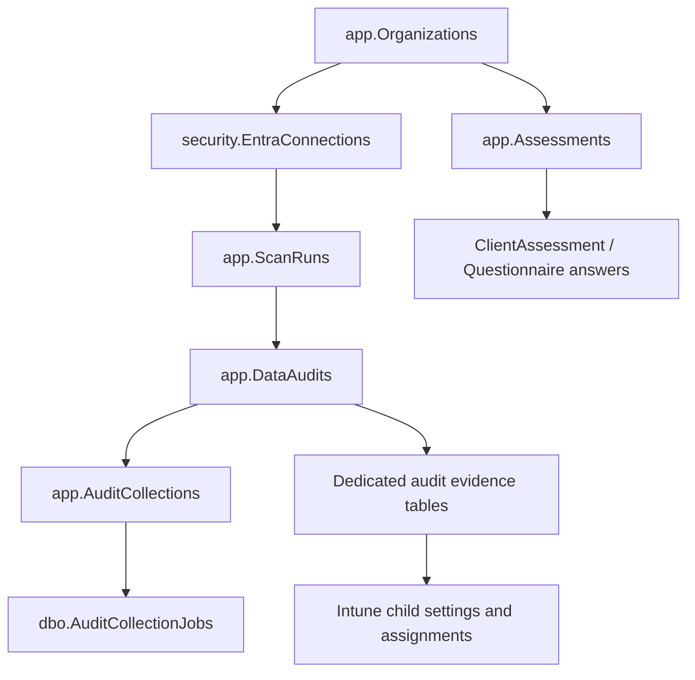

# NSO Audit data dictionary

Source inventory: November 10, 2026, migrations 001–019 and current API code. Covers **62 project tables** (61 migration-defined tables plus the migration ledger).
This documents the existing Dev application database `nso-audit-dev` in `NSO-Audit`. It is not a temporary database.
This is a **source-based dictionary**, not a fresh live-schema reconciliation. SQL tooling/system tables installed separately are not assumed to belong to this application.
Run [inspect-schema.sql](inspect-schema.sql) in SSMS to inspect the actual connected database's columns, keys, descriptions and dependencies without reading customer data or changing anything.

## Start here in SSMS

| You want to understand… | Start with |
| --- | --- |
| Which automated audits ran | `app.DataAudits`, then `app.ScanRuns` for all current/older history |
| Whether a dataset actually collected successfully | `app.AuditCollections` |
| The actual saved Microsoft configurations | Dedicated `app.Audit*` evidence tables below |
| Why collection is queued/running | `dbo.AuditCollectionJobs` and `app.AuditCollections` |
| Which customer owns the data | `app.Organizations` and `security.EntraConnections` |
| Who can sign in/access a workspace | `identitydata.Users`, `identitydata.Sessions`, `security.Memberships` |
| Manually entered questionnaire answers | `app.Assessments`, `app.ClientAssessment*`, or `app.Questionnaire*` |
| Which SQL changes have been applied | `dbo.SchemaMigrations` |

**An automated audit is not a questionnaire assessment.** `ScanId` identifies a collected audit snapshot; `AssessmentId` identifies a questionnaire. `app.AuditEvents` is an application activity log, not the Microsoft evidence collected by an audit.

## Schemas and common identifiers

| Schema | Meaning |
| --- | --- |
| `app` | Customer data, questionnaires, audit headers and collected evidence |
| `identitydata` | Email accounts, session/token hashes, invitations and management principals |
| `security` | Access mappings, membership, throttling and controlled SQL procedures |
| `questionnaire` | Shared, versioned question/section/option definitions |
| `dbo` | Operational queue, dependency map, cutover guard and migration ledger |

| Column/key | Meaning |
| --- | --- |
| `OrganizationId` | NSO customer/workspace boundary; not the Microsoft tenant ID |
| `TenantId` | Microsoft Entra tenant being audited |
| `ScanId` | Shared automated audit identifier across header, collections and evidence |
| `AssessmentId` | Manually completed questionnaire identifier |
| `SourceId` | Stable source identity; Intune child rows use a deterministic parent/child hash |
| `ParentSourceId`, `ChildSourceId` | Original Intune policy and child IDs; join using organization + tenant + scan + parent ID |
| `CollectedAtUtc`, `StoredAtUtc` | When evidence was observed versus persisted; not the source object's creation date |
| `SourceCreatedAtUtc`, `SourceUpdatedAtUtc` | Source-supplied object dates where available |
| `SourceJson`, `EntityJson`, `DefinitionJson` | Additional saved source evidence, legacy envelope, or catalog metadata respectively |
| `Revision` / management `Version` | Optimistic concurrency protection for edited forms/profiles |

Most customer `app` tables use organization row-level security (RLS). Security/identity/queue tables use restricted permissions and controlled procedures instead; do not assume every table has identical RLS.
A blank result in SSMS can be caused by organization context, not an empty database. The metadata script reports the predicates; it does not set an organization context or bypass isolation.
Never join customer data using a source ID alone. Completed snapshots should remain historical evidence, even in Dev. Schema/data cleanup is allowed when explicitly planned, but dependencies and recovery need to be understood.

## API/function legend

All HTTP paths below are on the existing Function API, with `/api` prefix. File names refer to `apps/api/src/functions/` unless another directory is given. These are **our application API endpoints**; Microsoft Graph/ARM paths are listed separately as collection sources.

| Path / trigger | Registered function / handler | SQL helper |
| --- | --- | --- |
| POST `/api/me/scans` | `startScan` | `audits/store.ts:createDataAudit` for unified audits; `saveStarterScan` for fallback |
| GET `/api/me/scans`, `/{scanId}` | `listScans`, `getScan` | `sqlTenantStore.ts:listTenantScans/getStarterScan` |
| POST `/api/me/audits` | `createDataAudit` / handler `createAudit` | `audits/store.ts:createDataAudit` (license-only entry) |
| GET `/api/me/audits/{scanId}` | `readDataAudit` / handler `readAudit` | `getDataAudit` |
| GET `/api/me/audits/{scanId}/{dataType}` | `readAuditEvidence` / handler `readEvidence` | `getSnapshotRows/getLicenseRows` |
| Every minute timer | `collectAuditData` | Claim -> start -> source page -> checkpoint; browser does not write evidence |
| GET `/api/me/bootstrap`; POST `/api/me/access-check` | `bootstrap`, `accessCheck` | `getTenantBootstrap/saveAccessCheck` |
| GET/POST `/api/account/{action}` | `customerAccounts` / handler `accounts` | `security.Auth*` procedures |
| `/api/management/customers[/{organizationId}]` | `managementCustomers/managementCustomer` / handler `manageCustomers` | `management/customerStore.ts` -> `security.Management*` |
| POST customer contact `/activate` or `/invite` | `activateCustomerContact/inviteCustomerContact` / handlers `activateContact/inviteContact` | Controlled contact/invitation procedures |
| GET/DELETE `/api/management/test-users[/{userId}]` | `listTestAccounts/deleteTestAccount` / handler `testAccounts` | Dev account cleanup procedures |
| `/api/me/questionnaires[/{assessmentId}]` | `questionnaires/questionnaire` / handler `questionnaires` | Direct scoped SQL and catalog/load/insertAnswer helpers |
| `/api/me/client-assessments/...` | `clientAssessments/clientAssessment/clientAssessmentGroups/clientAssessmentGroup/clientAssessmentReview` | `clientAssessments`, `loadClientAssessment`, insertAnswer helpers |

## How the main records connect

This is a conceptual map; exact declared foreign keys appear under each table and in the SSMS metadata script.

## Table inventory

The following describes normal application access plus important operator paths. Verification/fixture scripts may also touch tables and are not normal business writers. SQL procedure references include both reads and writes; consult the linked implementation for individual statements and later dynamic procedure alterations.

| Table | Area | What it stores |
| --- | --- | --- |
| [app.Answers](#appanswers) | Questionnaires | Original generic JSON answer model under an assessment. |
| [app.Assessments](#appassessments) | Questionnaires | Parent record for manually completed questionnaires: template version, state and creation time. |
| [app.AuditAppProtectionPolicies](#appauditappprotectionpolicies) | Collected evidence | App protection policies. Saved source evidence, not an automatically evaluated compliance finding. |
| [app.AuditAuthenticationMethods](#appauditauthenticationmethods) | Collected evidence | Authentication-method root policy and returned method configurations; not user authentication secrets. |
| [app.AuditAuthenticationRegistrations](#appauditauthenticationregistrations) | Collected evidence | Authentication registration. Saved source evidence, not an automatically evaluated compliance finding. |
| [app.AuditAuthorizationPolicies](#appauditauthorizationpolicies) | Collected evidence | Authorization policy. Saved source evidence, not an automatically evaluated compliance finding. |
| [app.AuditCollections](#appauditcollections) | Audit control | Per-audit dataset status, row count, start/end timestamps and safe error code. |
| [app.AuditCompliancePolicies](#appauditcompliancepolicies) | Collected evidence | Device compliance policies. Saved source evidence, not an automatically evaluated compliance finding. |
| [app.AuditCompliancePolicyAssignments](#appauditcompliancepolicyassignments) | Collected evidence | Compliance policy assignments. Saved source evidence, not an automatically evaluated compliance finding. |
| [app.AuditCompliancePolicyDetails](#appauditcompliancepolicydetails) | Collected evidence | Compliance policy settings. Saved source evidence, not an automatically evaluated compliance finding. |
| [app.AuditConditionalAccessPolicies](#appauditconditionalaccesspolicies) | Collected evidence | Conditional Access policies. Saved source evidence, not an automatically evaluated compliance finding. |
| [app.AuditDefenderAssessmentMetadata](#appauditdefenderassessmentmetadata) | Collected evidence | Defender assessment definitions. Reference/control definitions captured with the audit; not evidence that each control is implemented. |
| [app.AuditDefenderCloudScores](#appauditdefendercloudscores) | Collected evidence | Defender for Cloud scores. Saved source evidence, not an automatically evaluated compliance finding. |
| [app.AuditDefenderRecommendations](#appauditdefenderrecommendations) | Collected evidence | Defender for Cloud assessments. Saved source evidence, not an automatically evaluated compliance finding. |
| [app.AuditDeviceConfigurationAssignments](#appauditdeviceconfigurationassignments) | Collected evidence | Device configuration assignments. Saved source evidence, not an automatically evaluated compliance finding. |
| [app.AuditDeviceConfigurationDetails](#appauditdeviceconfigurationdetails) | Collected evidence | Device configuration settings. Saved source evidence, not an automatically evaluated compliance finding. |
| [app.AuditDeviceConfigurations](#appauditdeviceconfigurations) | Collected evidence | Device configuration profiles. Saved source evidence, not an automatically evaluated compliance finding. |
| [app.AuditEvents](#appauditevents) | Questionnaires | Application activity log: actor, action and event time, such as customer edits or questionnaire saves. |
| [app.AuditLicenseAssignments](#appauditlicenseassignments) | Collected evidence | User-to-SKU assignment paths: direct/group, state/error and disabled plans. |
| [app.AuditLicenses](#appauditlicenses) | Collected evidence | Tenant subscribed license SKU inventory: purchased/enabled/suspended/warning units and consumed counts. |
| [app.AuditMicrosoftSecureScores](#appauditmicrosoftsecurescores) | Collected evidence | Microsoft Secure Score source history returned during an audit; several historical source scores may belong to one NSO audit. |
| [app.AuditNamedLocations](#appauditnamedlocations) | Collected evidence | Named locations. Saved source evidence, not an automatically evaluated compliance finding. |
| [app.AuditResourceGroups](#appauditresourcegroups) | Collected evidence | Azure resource groups. Saved source evidence, not an automatically evaluated compliance finding. |
| [app.AuditRoleAssignments](#appauditroleassignments) | Collected evidence | Entra directory role assignments captured per audit, including expanded role definition and principal in SourceJson for new audits; DisplayName is the role name. Does not expand group membership or collect PIM eligibility. |
| [app.AuditSecureScoreProfiles](#appauditsecurescoreprofiles) | Collected evidence | Secure Score control profiles. Reference/control definitions captured with the audit; not evidence that each control is implemented. |
| [app.AuditSettingsCatalogAssignments](#appauditsettingscatalogassignments) | Collected evidence | Settings catalog assignments. Saved source evidence, not an automatically evaluated compliance finding. |
| [app.AuditSettingsCatalogPolicies](#appauditsettingscatalogpolicies) | Collected evidence | Settings catalog policies. Saved source evidence, not an automatically evaluated compliance finding. |
| [app.AuditSettingsCatalogSettings](#appauditsettingscatalogsettings) | Collected evidence | Settings catalog settings and definitions. Saved source evidence, not an automatically evaluated compliance finding. |
| [app.ClientAssessmentAnswers](#appclientassessmentanswers) | Questionnaires | Typed answers, record-list JSON, provenance and supporting evidence references per group/question. |
| [app.ClientAssessmentDetails](#appclientassessmentdetails) | Questionnaires | Client questionnaire header, name, owner/reviewer labels and optimistic revision. |
| [app.ClientAssessmentGroups](#appclientassessmentgroups) | Questionnaires | Named section instances, including repeatable technology or asset groups and context JSON. |
| [app.ClientAssessmentReviews](#appclientassessmentreviews) | Questionnaires | Reviewer conclusions, evidence/collection states and review metadata per group/question. |
| [app.ClientAssessmentSelections](#appclientassessmentselections) | Questionnaires | Multi-select options linked to an answer in a specific assessment group. |
| [app.CustomerContacts](#appcustomercontacts) | Customers | Customer contact roster, intended roles and account/invitation links. |
| [app.CustomerProfiles](#appcustomerprofiles) | Customers | Extended customer profile as structured JSON, keyed by organization. |
| [app.DataAudits](#appdataaudits) | Audit control | Typed audit header: scope, initiator, collector version, subscription, lifecycle and timestamps. |
| [app.Organizations](#apporganizations) | Customers | NSO customer/workspace identity and active/suspended state. |
| [app.QuestionnaireAnswerSelections](#appquestionnaireanswerselections) | Questionnaires | One selected option per row for multi-select backup answers. |
| [app.QuestionnaireAnswers](#appquestionnaireanswers) | Questionnaires | Typed answers and evidence references for the original backup questionnaire. |
| [app.QuestionnaireScopes](#appquestionnairescopes) | Questionnaires | Backup questionnaire scope: name, asset class, tenant and optimistic revision. |
| [app.ScanFindings](#appscanfindings) | Audit control | Legacy scorecard findings and saved finding evidence JSON per scan/check. |
| [app.ScanRuns](#appscanruns) | Audit control | Common scan-history envelope for both older scorecards and current typed audits. |
| [app.TenantRegistrations](#apptenantregistrations) | Audit control | Tenant setup/access-check JSON and pointer to the latest scan. |
| [dbo.AuditCollectionJobs](#dboauditcollectionjobs) | Audit control | Durable worker queue: audit/dataset, paging cursor, lease, attempt count and finished flag. |
| [dbo.AuditDatasetDependencies](#dboauditdatasetdependencies) | Audit control | Static child-to-parent dataset dependency map for Intune collection order. |
| [dbo.ScanStorageCutover](#dboscanstoragecutover) | Audit control | Single-row guard identifying the active scan backend and migration verification metadata. |
| [dbo.SchemaMigrations](#dboschemamigrations) | Audit control | Applied migration filenames, normalized SHA-256 checksums and application timestamps. |
| [identitydata.AccountTokens](#identitydataaccounttokens) | Accounts | Hashed one-time email verification and password-reset tokens. |
| [identitydata.ManagementUsers](#identitydatamanagementusers) | Accounts | Approved Entra staff principals and setupAdmin/platformAdmin roles. |
| [identitydata.RegistrationRequests](#identitydataregistrationrequests) | Accounts | Original registration-review requests linked to an email user. |
| [identitydata.Sessions](#identitydatasessions) | Accounts | Hashed email login sessions, expiration and revocation. |
| [identitydata.Users](#identitydatausers) | Accounts | Customer email accounts: identity, password hash, verification and disabled state. |
| [identitydata.WorkspaceInvitations](#identitydataworkspaceinvitations) | Accounts | Hashed workspace invitation tokens, invited email/role, expiry, acceptance and delivery state. |
| [questionnaire.ClientQuestionDefinitions](#questionnaireclientquestiondefinitions) | Questionnaire catalog | Versioned detailed question metadata, section mapping, source IDs and definition JSON. |
| [questionnaire.ClientSections](#questionnaireclientsections) | Questionnaire catalog | Versioned client-assessment section definitions, repeatability and presentation metadata. |
| [questionnaire.QuestionOptions](#questionnairequestionoptions) | Questionnaire catalog | Allowed option IDs/labels for each versioned question. |
| [questionnaire.Questions](#questionnairequestions) | Questionnaire catalog | Versioned question prompts, answer types, positions and template membership. |
| [security.AuthAttempts](#securityauthattempts) | Access | Hashed rate-limit buckets and request windows for account operations. |
| [security.CustomerDirectory](#securitycustomerdirectory) | Customers | Management directory of organizations, primary contact and concurrency revision. |
| [security.EntraConnections](#securityentraconnections) | Access | Approved mapping of a Microsoft tenant to an NSO customer organization. |
| [security.Memberships](#securitymemberships) | Access | Email user roles within each organization: owner/admin/contributor/viewer. |
| [security.WorkspaceOwnershipRequests](#securityworkspaceownershiprequests) | Access | Operator-nominated pending/fulfilled customer workspace ownership requests. |

### Audit control

#### app.AuditCollections

- **Stores:** Per-audit dataset status, row count, start/end timestamps and safe error code.
- **Read by:** dataAudits.ts: readAudit -> getDataAudit; nextIntuneParent; queue procedures
- **Written by:** createDataAudit creates requested datasets; startCollection/checkpointCollection update progress
- **Primary key (creation DDL):** `OrganizationId,TenantId,ScanId,DataType`
- **Parent relationships (creation DDL):** app.DataAudits (OrganizationId,TenantId,ScanId)
- **Lifecycle / cautions:** Distinguish empty complete, missingAccess, failed and partial. This is dataset status, not individual evidence.
- **Schema sources:** [database/migrations/017_audit_licensing.sql](../database/migrations/017_audit_licensing.sql), [database/migrations/018_tenant_audit_datasets.sql](../database/migrations/018_tenant_audit_datasets.sql), [database/migrations/019_intune_policy_details.sql](../database/migrations/019_intune_policy_details.sql)
- **Application implementation:** [apps/api/src/audits/store.ts](../apps/api/src/audits/store.ts), [apps/api/src/functions/dataAudits.ts](../apps/api/src/functions/dataAudits.ts)
- **SQL procedures referencing this table:** `security.EnqueueAuditCollection (017_audit_licensing.sql)`

#### app.DataAudits

- **Stores:** Typed audit header: scope, initiator, collector version, subscription, lifecycle and timestamps.
- **Read by:** dataAudits.ts: readAudit -> getDataAudit; worker getJobSubscription
- **Written by:** scans.ts: startScan and dataAudits.ts: createAudit -> createDataAudit; timer -> startCollection/checkpointCollection
- **Primary key (creation DDL):** `OrganizationId,TenantId,ScanId`
- **Parent relationships (creation DDL):** app.ScanRuns (OrganizationId,TenantId,ScanId)
- **Lifecycle / cautions:** One typed run; completed evidence retained as a snapshot. A complete run covers its requested datasets only.
- **Schema sources:** [database/migrations/017_audit_licensing.sql](../database/migrations/017_audit_licensing.sql), [database/migrations/018_tenant_audit_datasets.sql](../database/migrations/018_tenant_audit_datasets.sql), [database/migrations/019_intune_policy_details.sql](../database/migrations/019_intune_policy_details.sql)
- **Application implementation:** [apps/api/src/audits/store.ts](../apps/api/src/audits/store.ts), [apps/api/src/functions/dataAudits.ts](../apps/api/src/functions/dataAudits.ts), [apps/api/src/functions/scans.ts](../apps/api/src/functions/scans.ts)

#### app.ScanFindings

- **Stores:** Legacy scorecard findings and saved finding evidence JSON per scan/check.
- **Read by:** scans.ts: getScan -> getStarterScan
- **Written by:** scans.ts: startScan -> saveStarterScan when unified collection is disabled; migration/backfill tooling
- **Primary key (creation DDL):** `OrganizationId,TenantId,ScanId,CheckId`
- **Parent relationships (creation DDL):** app.ScanRuns (OrganizationId,TenantId,ScanId)
- **Lifecycle / cautions:** Historical/fallback model; new typed evidence is stored in dedicated Audit* tables, not here.
- **Schema sources:** [database/migrations/003_scan_storage.sql](../database/migrations/003_scan_storage.sql)
- **Application implementation:** [apps/api/src/functions/scans.ts](../apps/api/src/functions/scans.ts), [apps/api/src/storage/sqlTenantStore.ts](../apps/api/src/storage/sqlTenantStore.ts)

#### app.ScanRuns

- **Stores:** Common scan-history envelope for both older scorecards and current typed audits.
- **Read by:** sqlTenantStore.ts: getTenantBootstrap/getStarterScan/listTenantScans — bootstrap, getScan, listScans handlers
- **Written by:** scans.ts: startScan -> createDataAudit or saveStarterScan; startCollection/checkpointCollection update status JSON
- **Primary key (creation DDL):** `OrganizationId,TenantId,ScanId`
- **Parent relationships (creation DDL):** security.EntraConnections (OrganizationId,TenantId)
- **Lifecycle / cautions:** Shared ScanId links to DataAudits. Historical JSON scans need not have a DataAudits row.
- **Schema sources:** [database/migrations/003_scan_storage.sql](../database/migrations/003_scan_storage.sql), [database/migrations/017_audit_licensing.sql](../database/migrations/017_audit_licensing.sql)
- **Application implementation:** [apps/api/src/audits/store.ts](../apps/api/src/audits/store.ts), [apps/api/src/functions/scans.ts](../apps/api/src/functions/scans.ts), [apps/api/src/storage/sqlTenantStore.ts](../apps/api/src/storage/sqlTenantStore.ts)

#### app.TenantRegistrations

- **Stores:** Tenant setup/access-check JSON and pointer to the latest scan.
- **Read by:** sqlTenantStore.ts: getTenantBootstrap/getStarterScan/listTenantScans — bootstrap, getScan, listScans handlers
- **Written by:** accessCheck.ts: accessCheck -> saveAccessCheck/mergeRegistration; saveStarterScan; audits/store.ts: createDataAudit
- **Primary key (creation DDL):** `OrganizationId,TenantId`
- **Parent relationships (creation DDL):** security.EntraConnections (OrganizationId,TenantId)
- **Lifecycle / cautions:** Current setup pointer/state; not the source of all historical audits.
- **Schema sources:** [database/migrations/003_scan_storage.sql](../database/migrations/003_scan_storage.sql)
- **Application implementation:** [apps/api/src/audits/store.ts](../apps/api/src/audits/store.ts), [apps/api/src/functions/accessCheck.ts](../apps/api/src/functions/accessCheck.ts), [apps/api/src/storage/sqlTenantStore.ts](../apps/api/src/storage/sqlTenantStore.ts)

#### dbo.AuditCollectionJobs

- **Stores:** Durable worker queue: audit/dataset, paging cursor, lease, attempt count and finished flag.
- **Read by:** collectAuditData -> claimCollection -> ClaimAuditCollection; LockAuditCollection
- **Written by:** createDataAudit -> EnqueueAuditCollection; ClaimAuditCollection and CheckpointAuditCollection
- **Primary key (creation DDL):** `OrganizationId,TenantId,ScanId,DataType`
- **Parent relationships (creation DDL):** app.AuditCollections (OrganizationId,TenantId,ScanId,DataType)
- **Lifecycle / cautions:** Operational queue. Do not manually flip Finished or edit cursors to fix a report; leases fence stale workers.
- **Schema sources:** [database/migrations/017_audit_licensing.sql](../database/migrations/017_audit_licensing.sql), [database/migrations/019_intune_policy_details.sql](../database/migrations/019_intune_policy_details.sql)
- **SQL procedures referencing this table:** `security.EnqueueAuditCollection (017_audit_licensing.sql)`; `security.ClaimAuditCollection (019_intune_policy_details.sql)`; `security.LockAuditCollection (017_audit_licensing.sql)`; `security.CheckpointAuditCollection (017_audit_licensing.sql)`

#### dbo.AuditDatasetDependencies

- **Stores:** Static child-to-parent dataset dependency map for Intune collection order.
- **Read by:** collectAuditData -> ClaimAuditCollection
- **Written by:** Migration 019 via scripts/database.mjs migrate; no runtime writer.
- **Primary key (creation DDL):** `DataType`
- **Parent relationships (creation DDL):** No table foreign key in original CREATE TABLE; see later migrations/live metadata.
- **Lifecycle / cautions:** Reference configuration, not tenant evidence. Children wait for parent inventory to become terminal.
- **Schema sources:** [database/migrations/019_intune_policy_details.sql](../database/migrations/019_intune_policy_details.sql)
- **SQL procedures referencing this table:** `security.ClaimAuditCollection (019_intune_policy_details.sql)`

#### dbo.ScanStorageCutover

- **Stores:** Single-row guard identifying the active scan backend and migration verification metadata.
- **Read by:** assertSqlCutoverActivated -> GetScanStorageState; SQL audit paths and health checks where applicable
- **Written by:** scripts/migrate-table-data.mjs activate; Complete-NsoAuditSqlCutover.ps1 orchestrates cutover
- **Primary key (creation DDL):** `Id`
- **Parent relationships (creation DDL):** No table foreign key in original CREATE TABLE; see later migrations/live metadata.
- **Lifecycle / cautions:** Operational migration guard; SQL is the approved current backend. Not a customer setting.
- **Schema sources:** [database/migrations/003_scan_storage.sql](../database/migrations/003_scan_storage.sql), [database/migrations/004_cutover_guard.sql](../database/migrations/004_cutover_guard.sql)
- **SQL procedures referencing this table:** `security.GetScanStorageState (004_cutover_guard.sql)`

#### dbo.SchemaMigrations

- **Stores:** Applied migration filenames, normalized SHA-256 checksums and application timestamps.
- **Read by:** scripts/database.mjs migrate
- **Written by:** scripts/database.mjs migrate creates/updates ledger in the migration transaction.
- **Primary key (creation DDL):** `Name`
- **Parent relationships (creation DDL):** No table foreign key in original CREATE TABLE; see later migrations/live metadata.
- **Lifecycle / cautions:** Created by migration runner, not a numbered migration. Never edit checksums to hide drift.
- **Schema source:** [scripts/database.mjs](../scripts/database.mjs)

### Collected evidence

#### app.AuditAppProtectionPolicies

- **Stores:** App protection policies. Saved source evidence, not an automatically evaluated compliance finding.
- **Read by:** dataAudits.ts: readEvidence — GET /api/me/audits/{scanId}/{dataType} -> audits/store.ts: getSnapshotRows (dataType=appProtectionPolicies)
- **Written by:** dataAudits.ts: collectAuditData timer -> audits/store.ts: checkpointCollection (insertPage) via collectSnapshot/fetchSnapshotPage
- **Primary key (creation DDL):** `OrganizationId,TenantId,ScanId,SourceId`
- **Parent relationships (creation DDL):** app.DataAudits (OrganizationId,TenantId,ScanId)
- **Lifecycle / cautions:** Snapshot; Device & Endpoint Management. Graph GET /v1.0/deviceAppManagement/managedAppPolicies.
- **Schema sources:** [database/migrations/018_tenant_audit_datasets.sql](../database/migrations/018_tenant_audit_datasets.sql)
- **Application implementation:** [apps/api/src/audits/catalog.ts](../apps/api/src/audits/catalog.ts), [apps/api/src/audits/store.ts](../apps/api/src/audits/store.ts), [apps/api/src/functions/dataAudits.ts](../apps/api/src/functions/dataAudits.ts)

#### app.AuditAuthenticationMethods

- **Stores:** Authentication-method root policy and returned method configurations; not user authentication secrets.
- **Read by:** dataAudits.ts: readEvidence — GET /api/me/audits/{scanId}/{dataType} -> audits/store.ts: getSnapshotRows (dataType=authenticationMethods)
- **Written by:** dataAudits.ts: collectAuditData timer -> audits/store.ts: checkpointCollection (insertPage) via collectSnapshot/fetchSnapshotPage
- **Primary key (creation DDL):** `OrganizationId,TenantId,ScanId,SourceId`
- **Parent relationships (creation DDL):** app.DataAudits (OrganizationId,TenantId,ScanId)
- **Lifecycle / cautions:** Snapshot; Identity & Access. Graph GET /v1.0/policies/authenticationMethodsPolicy.
- **Schema sources:** [database/migrations/018_tenant_audit_datasets.sql](../database/migrations/018_tenant_audit_datasets.sql)
- **Application implementation:** [apps/api/src/audits/catalog.ts](../apps/api/src/audits/catalog.ts), [apps/api/src/audits/store.ts](../apps/api/src/audits/store.ts), [apps/api/src/functions/dataAudits.ts](../apps/api/src/functions/dataAudits.ts)

#### app.AuditAuthenticationRegistrations

- **Stores:** Authentication registration. Saved source evidence, not an automatically evaluated compliance finding.
- **Read by:** dataAudits.ts: readEvidence — GET /api/me/audits/{scanId}/{dataType} -> audits/store.ts: getSnapshotRows (dataType=registrations)
- **Written by:** dataAudits.ts: collectAuditData timer -> audits/store.ts: checkpointCollection (insertPage) via collectSnapshot/fetchSnapshotPage
- **Primary key (creation DDL):** `OrganizationId,TenantId,ScanId,SourceId`
- **Parent relationships (creation DDL):** app.DataAudits (OrganizationId,TenantId,ScanId)
- **Lifecycle / cautions:** Snapshot; Identity & Access. Graph GET /v1.0/reports/authenticationMethods/userRegistrationDetails.
- **Schema sources:** [database/migrations/018_tenant_audit_datasets.sql](../database/migrations/018_tenant_audit_datasets.sql)
- **Application implementation:** [apps/api/src/audits/catalog.ts](../apps/api/src/audits/catalog.ts), [apps/api/src/audits/store.ts](../apps/api/src/audits/store.ts), [apps/api/src/functions/dataAudits.ts](../apps/api/src/functions/dataAudits.ts)

#### app.AuditAuthorizationPolicies

- **Stores:** Authorization policy. Saved source evidence, not an automatically evaluated compliance finding.
- **Read by:** dataAudits.ts: readEvidence — GET /api/me/audits/{scanId}/{dataType} -> audits/store.ts: getSnapshotRows (dataType=authorizationPolicy)
- **Written by:** dataAudits.ts: collectAuditData timer -> audits/store.ts: checkpointCollection (insertPage) via collectSnapshot/fetchSnapshotPage
- **Primary key (creation DDL):** `OrganizationId,TenantId,ScanId,SourceId`
- **Parent relationships (creation DDL):** app.DataAudits (OrganizationId,TenantId,ScanId)
- **Lifecycle / cautions:** Snapshot; Identity & Access. Graph GET /v1.0/policies/authorizationPolicy.
- **Schema sources:** [database/migrations/018_tenant_audit_datasets.sql](../database/migrations/018_tenant_audit_datasets.sql)
- **Application implementation:** [apps/api/src/audits/catalog.ts](../apps/api/src/audits/catalog.ts), [apps/api/src/audits/store.ts](../apps/api/src/audits/store.ts), [apps/api/src/functions/dataAudits.ts](../apps/api/src/functions/dataAudits.ts)

#### app.AuditCompliancePolicies

- **Stores:** Device compliance policies. Saved source evidence, not an automatically evaluated compliance finding.
- **Read by:** dataAudits.ts: readEvidence — GET /api/me/audits/{scanId}/{dataType} -> audits/store.ts: getSnapshotRows (dataType=compliancePolicies)
- **Written by:** dataAudits.ts: collectAuditData timer -> audits/store.ts: checkpointCollection (insertPage) via collectSnapshot/fetchSnapshotPage
- **Primary key (creation DDL):** `OrganizationId,TenantId,ScanId,SourceId`
- **Parent relationships (creation DDL):** app.DataAudits (OrganizationId,TenantId,ScanId)
- **Lifecycle / cautions:** Snapshot; Device & Endpoint Management. Graph GET /v1.0/deviceManagement/deviceCompliancePolicies.
- **Schema sources:** [database/migrations/018_tenant_audit_datasets.sql](../database/migrations/018_tenant_audit_datasets.sql), [database/migrations/019_intune_policy_details.sql](../database/migrations/019_intune_policy_details.sql)
- **Application implementation:** [apps/api/src/audits/catalog.ts](../apps/api/src/audits/catalog.ts), [apps/api/src/audits/store.ts](../apps/api/src/audits/store.ts), [apps/api/src/functions/dataAudits.ts](../apps/api/src/functions/dataAudits.ts)

#### app.AuditCompliancePolicyAssignments

- **Stores:** Compliance policy assignments. Saved source evidence, not an automatically evaluated compliance finding.
- **Read by:** dataAudits.ts: readEvidence — GET /api/me/audits/{scanId}/{dataType} -> audits/store.ts: getSnapshotRows (dataType=compliancePolicyAssignments)
- **Written by:** dataAudits.ts: collectAuditData timer -> audits/store.ts: checkpointCollection (insertPage) via nextIntuneParent/fetchIntuneChildPage
- **Primary key (creation DDL):** `OrganizationId,TenantId,ScanId,SourceId`
- **Parent relationships (creation DDL):** app.AuditCompliancePolicies (OrganizationId,TenantId,ScanId,SourceId); app.DataAudits (OrganizationId,TenantId,ScanId)
- **Lifecycle / cautions:** Snapshot; Device & Endpoint Management. Graph GET /v1.0/deviceManagement/deviceCompliancePolicies/{policyId}/assignments. Parent dataset: compliancePolicies. Child IDs are local to a policy; ParentSourceId links within the same organization, tenant and ScanId.
- **Schema sources:** [database/migrations/019_intune_policy_details.sql](../database/migrations/019_intune_policy_details.sql)
- **Application implementation:** [apps/api/src/audits/catalog.ts](../apps/api/src/audits/catalog.ts), [apps/api/src/audits/store.ts](../apps/api/src/audits/store.ts), [apps/api/src/functions/dataAudits.ts](../apps/api/src/functions/dataAudits.ts)

#### app.AuditCompliancePolicyDetails

- **Stores:** Compliance policy settings. Saved source evidence, not an automatically evaluated compliance finding.
- **Read by:** dataAudits.ts: readEvidence — GET /api/me/audits/{scanId}/{dataType} -> audits/store.ts: getSnapshotRows (dataType=compliancePolicyDetails)
- **Written by:** dataAudits.ts: collectAuditData timer -> audits/store.ts: checkpointCollection (insertPage) via nextIntuneParent/fetchIntuneChildPage
- **Primary key (creation DDL):** `OrganizationId,TenantId,ScanId,SourceId`
- **Parent relationships (creation DDL):** app.AuditCompliancePolicies (OrganizationId,TenantId,ScanId,SourceId); app.DataAudits (OrganizationId,TenantId,ScanId)
- **Lifecycle / cautions:** Snapshot; Device & Endpoint Management. Graph GET /v1.0/deviceManagement/deviceCompliancePolicies/{policyId}. Parent dataset: compliancePolicies. Child IDs are local to a policy; ParentSourceId links within the same organization, tenant and ScanId.
- **Schema sources:** [database/migrations/019_intune_policy_details.sql](../database/migrations/019_intune_policy_details.sql)
- **Application implementation:** [apps/api/src/audits/catalog.ts](../apps/api/src/audits/catalog.ts), [apps/api/src/audits/store.ts](../apps/api/src/audits/store.ts), [apps/api/src/functions/dataAudits.ts](../apps/api/src/functions/dataAudits.ts)

#### app.AuditConditionalAccessPolicies

- **Stores:** Conditional Access policies. Saved source evidence, not an automatically evaluated compliance finding.
- **Read by:** dataAudits.ts: readEvidence — GET /api/me/audits/{scanId}/{dataType} -> audits/store.ts: getSnapshotRows (dataType=conditionalAccess)
- **Written by:** dataAudits.ts: collectAuditData timer -> audits/store.ts: checkpointCollection (insertPage) via collectSnapshot/fetchSnapshotPage
- **Primary key (creation DDL):** `OrganizationId,TenantId,ScanId,SourceId`
- **Parent relationships (creation DDL):** app.DataAudits (OrganizationId,TenantId,ScanId)
- **Lifecycle / cautions:** Snapshot; Identity & Access. Graph GET /v1.0/identity/conditionalAccess/policies.
- **Schema sources:** [database/migrations/018_tenant_audit_datasets.sql](../database/migrations/018_tenant_audit_datasets.sql)
- **Application implementation:** [apps/api/src/audits/catalog.ts](../apps/api/src/audits/catalog.ts), [apps/api/src/audits/store.ts](../apps/api/src/audits/store.ts), [apps/api/src/functions/dataAudits.ts](../apps/api/src/functions/dataAudits.ts)

#### app.AuditDefenderAssessmentMetadata

- **Stores:** Defender assessment definitions. Reference/control definitions captured with the audit; not evidence that each control is implemented.
- **Read by:** dataAudits.ts: readEvidence — GET /api/me/audits/{scanId}/{dataType} -> audits/store.ts: getSnapshotRows (dataType=defenderMetadata)
- **Written by:** dataAudits.ts: collectAuditData timer -> audits/store.ts: checkpointCollection (insertPage) via collectSnapshot/fetchSnapshotPage
- **Primary key (creation DDL):** `OrganizationId,TenantId,ScanId,SourceId`
- **Parent relationships (creation DDL):** app.DataAudits (OrganizationId,TenantId,ScanId)
- **Lifecycle / cautions:** Snapshot; Threat Protection & Security Operations. ARM GET /subscriptions/{subscriptionId}/providers/Microsoft.Security/assessmentMetadata?api-version=2021-06-01.
- **Schema sources:** [database/migrations/018_tenant_audit_datasets.sql](../database/migrations/018_tenant_audit_datasets.sql)
- **Application implementation:** [apps/api/src/audits/catalog.ts](../apps/api/src/audits/catalog.ts), [apps/api/src/audits/store.ts](../apps/api/src/audits/store.ts), [apps/api/src/functions/dataAudits.ts](../apps/api/src/functions/dataAudits.ts)

#### app.AuditDefenderCloudScores

- **Stores:** Defender for Cloud scores. Saved source evidence, not an automatically evaluated compliance finding.
- **Read by:** dataAudits.ts: readEvidence — GET /api/me/audits/{scanId}/{dataType} -> audits/store.ts: getSnapshotRows (dataType=defenderScores)
- **Written by:** dataAudits.ts: collectAuditData timer -> audits/store.ts: checkpointCollection (insertPage) via collectSnapshot/fetchSnapshotPage
- **Primary key (creation DDL):** `OrganizationId,TenantId,ScanId,SourceId`
- **Parent relationships (creation DDL):** app.DataAudits (OrganizationId,TenantId,ScanId)
- **Lifecycle / cautions:** Snapshot; Scores. ARM GET /subscriptions/{subscriptionId}/providers/Microsoft.Security/secureScores?api-version=2020-01-01.
- **Schema sources:** [database/migrations/018_tenant_audit_datasets.sql](../database/migrations/018_tenant_audit_datasets.sql)
- **Application implementation:** [apps/api/src/audits/catalog.ts](../apps/api/src/audits/catalog.ts), [apps/api/src/audits/store.ts](../apps/api/src/audits/store.ts), [apps/api/src/functions/dataAudits.ts](../apps/api/src/functions/dataAudits.ts)

#### app.AuditDefenderRecommendations

- **Stores:** Defender for Cloud assessments. Saved source evidence, not an automatically evaluated compliance finding.
- **Read by:** dataAudits.ts: readEvidence — GET /api/me/audits/{scanId}/{dataType} -> audits/store.ts: getSnapshotRows (dataType=defenderRecommendations)
- **Written by:** dataAudits.ts: collectAuditData timer -> audits/store.ts: checkpointCollection (insertPage) via collectSnapshot/fetchSnapshotPage
- **Primary key (creation DDL):** `OrganizationId,TenantId,ScanId,SourceId`
- **Parent relationships (creation DDL):** app.DataAudits (OrganizationId,TenantId,ScanId)
- **Lifecycle / cautions:** Snapshot; Threat Protection & Security Operations. ARM GET /subscriptions/{subscriptionId}/providers/Microsoft.Security/assessments?api-version=2021-06-01.
- **Schema sources:** [database/migrations/018_tenant_audit_datasets.sql](../database/migrations/018_tenant_audit_datasets.sql)
- **Application implementation:** [apps/api/src/audits/catalog.ts](../apps/api/src/audits/catalog.ts), [apps/api/src/audits/store.ts](../apps/api/src/audits/store.ts), [apps/api/src/functions/dataAudits.ts](../apps/api/src/functions/dataAudits.ts)

#### app.AuditDeviceConfigurationAssignments

- **Stores:** Device configuration assignments. Saved source evidence, not an automatically evaluated compliance finding.
- **Read by:** dataAudits.ts: readEvidence — GET /api/me/audits/{scanId}/{dataType} -> audits/store.ts: getSnapshotRows (dataType=deviceConfigurationAssignments)
- **Written by:** dataAudits.ts: collectAuditData timer -> audits/store.ts: checkpointCollection (insertPage) via nextIntuneParent/fetchIntuneChildPage
- **Primary key (creation DDL):** `OrganizationId,TenantId,ScanId,SourceId`
- **Parent relationships (creation DDL):** app.AuditDeviceConfigurations (OrganizationId,TenantId,ScanId,SourceId); app.DataAudits (OrganizationId,TenantId,ScanId)
- **Lifecycle / cautions:** Snapshot; Device & Endpoint Management. Graph GET /v1.0/deviceManagement/deviceConfigurations/{policyId}/assignments. Parent dataset: deviceConfigurations. Child IDs are local to a policy; ParentSourceId links within the same organization, tenant and ScanId.
- **Schema sources:** [database/migrations/019_intune_policy_details.sql](../database/migrations/019_intune_policy_details.sql)
- **Application implementation:** [apps/api/src/audits/catalog.ts](../apps/api/src/audits/catalog.ts), [apps/api/src/audits/store.ts](../apps/api/src/audits/store.ts), [apps/api/src/functions/dataAudits.ts](../apps/api/src/functions/dataAudits.ts)

#### app.AuditDeviceConfigurationDetails

- **Stores:** Device configuration settings. Saved source evidence, not an automatically evaluated compliance finding.
- **Read by:** dataAudits.ts: readEvidence — GET /api/me/audits/{scanId}/{dataType} -> audits/store.ts: getSnapshotRows (dataType=deviceConfigurationDetails)
- **Written by:** dataAudits.ts: collectAuditData timer -> audits/store.ts: checkpointCollection (insertPage) via nextIntuneParent/fetchIntuneChildPage
- **Primary key (creation DDL):** `OrganizationId,TenantId,ScanId,SourceId`
- **Parent relationships (creation DDL):** app.AuditDeviceConfigurations (OrganizationId,TenantId,ScanId,SourceId); app.DataAudits (OrganizationId,TenantId,ScanId)
- **Lifecycle / cautions:** Snapshot; Device & Endpoint Management. Graph GET /v1.0/deviceManagement/deviceConfigurations/{policyId}. Parent dataset: deviceConfigurations. Child IDs are local to a policy; ParentSourceId links within the same organization, tenant and ScanId.
- **Schema sources:** [database/migrations/019_intune_policy_details.sql](../database/migrations/019_intune_policy_details.sql)
- **Application implementation:** [apps/api/src/audits/catalog.ts](../apps/api/src/audits/catalog.ts), [apps/api/src/audits/store.ts](../apps/api/src/audits/store.ts), [apps/api/src/functions/dataAudits.ts](../apps/api/src/functions/dataAudits.ts)

#### app.AuditDeviceConfigurations

- **Stores:** Device configuration profiles. Saved source evidence, not an automatically evaluated compliance finding.
- **Read by:** dataAudits.ts: readEvidence — GET /api/me/audits/{scanId}/{dataType} -> audits/store.ts: getSnapshotRows (dataType=deviceConfigurations)
- **Written by:** dataAudits.ts: collectAuditData timer -> audits/store.ts: checkpointCollection (insertPage) via collectSnapshot/fetchSnapshotPage
- **Primary key (creation DDL):** `OrganizationId,TenantId,ScanId,SourceId`
- **Parent relationships (creation DDL):** app.DataAudits (OrganizationId,TenantId,ScanId)
- **Lifecycle / cautions:** Snapshot; Device & Endpoint Management. Graph GET /v1.0/deviceManagement/deviceConfigurations.
- **Schema sources:** [database/migrations/018_tenant_audit_datasets.sql](../database/migrations/018_tenant_audit_datasets.sql), [database/migrations/019_intune_policy_details.sql](../database/migrations/019_intune_policy_details.sql)
- **Application implementation:** [apps/api/src/audits/catalog.ts](../apps/api/src/audits/catalog.ts), [apps/api/src/audits/store.ts](../apps/api/src/audits/store.ts), [apps/api/src/functions/dataAudits.ts](../apps/api/src/functions/dataAudits.ts)

#### app.AuditLicenseAssignments

- **Stores:** User-to-SKU assignment paths: direct/group, state/error and disabled plans.
- **Read by:** readEvidence -> getLicenseRows (dataType=licenseAssignments)
- **Written by:** dataAudits.ts: collectAuditData timer -> audits/store.ts: checkpointCollection (insertPage) via processCollection/fetchLicensePage/normalizeAssignments
- **Primary key (creation DDL):** `OrganizationId,TenantId,ScanId,UserId,SkuId,AssignmentSource`
- **Parent relationships (creation DDL):** app.DataAudits (OrganizationId,TenantId,ScanId)
- **Lifecycle / cautions:** Snapshot per audit; Graph GET /v1.0/users with selected licensing fields. Rows are assignment paths, not unique users.
- **Schema sources:** [database/migrations/017_audit_licensing.sql](../database/migrations/017_audit_licensing.sql)
- **Application implementation:** [apps/api/src/audits/catalog.ts](../apps/api/src/audits/catalog.ts), [apps/api/src/audits/store.ts](../apps/api/src/audits/store.ts), [apps/api/src/functions/dataAudits.ts](../apps/api/src/functions/dataAudits.ts)

#### app.AuditLicenses

- **Stores:** Tenant subscribed license SKU inventory: purchased/enabled/suspended/warning units and consumed counts.
- **Read by:** readEvidence -> getLicenseRows (dataType=licenses)
- **Written by:** dataAudits.ts: collectAuditData timer -> audits/store.ts: checkpointCollection (insertPage) via processCollection/fetchLicensePage/normalizeLicenses
- **Primary key (creation DDL):** `OrganizationId,TenantId,ScanId,SourceId`
- **Parent relationships (creation DDL):** app.DataAudits (OrganizationId,TenantId,ScanId)
- **Lifecycle / cautions:** Snapshot per audit; Graph GET /v1.0/subscribedSkus. Product names may fall back to SKU.
- **Schema sources:** [database/migrations/017_audit_licensing.sql](../database/migrations/017_audit_licensing.sql)
- **Application implementation:** [apps/api/src/audits/catalog.ts](../apps/api/src/audits/catalog.ts), [apps/api/src/audits/store.ts](../apps/api/src/audits/store.ts), [apps/api/src/functions/dataAudits.ts](../apps/api/src/functions/dataAudits.ts)

#### app.AuditMicrosoftSecureScores

- **Stores:** Microsoft Secure Score source history returned during an audit; several historical source scores may belong to one NSO audit.
- **Read by:** dataAudits.ts: readEvidence — GET /api/me/audits/{scanId}/{dataType} -> audits/store.ts: getSnapshotRows (dataType=secureScores)
- **Written by:** dataAudits.ts: collectAuditData timer -> audits/store.ts: checkpointCollection (insertPage) via collectSnapshot/fetchSnapshotPage
- **Primary key (creation DDL):** `OrganizationId,TenantId,ScanId,SourceId`
- **Parent relationships (creation DDL):** app.DataAudits (OrganizationId,TenantId,ScanId)
- **Lifecycle / cautions:** Snapshot; Scores. Graph GET /v1.0/security/secureScores.
- **Schema sources:** [database/migrations/018_tenant_audit_datasets.sql](../database/migrations/018_tenant_audit_datasets.sql)
- **Application implementation:** [apps/api/src/audits/catalog.ts](../apps/api/src/audits/catalog.ts), [apps/api/src/audits/store.ts](../apps/api/src/audits/store.ts), [apps/api/src/functions/dataAudits.ts](../apps/api/src/functions/dataAudits.ts)

#### app.AuditNamedLocations

- **Stores:** Named locations. Saved source evidence, not an automatically evaluated compliance finding.
- **Read by:** dataAudits.ts: readEvidence — GET /api/me/audits/{scanId}/{dataType} -> audits/store.ts: getSnapshotRows (dataType=namedLocations)
- **Written by:** dataAudits.ts: collectAuditData timer -> audits/store.ts: checkpointCollection (insertPage) via collectSnapshot/fetchSnapshotPage
- **Primary key (creation DDL):** `OrganizationId,TenantId,ScanId,SourceId`
- **Parent relationships (creation DDL):** app.DataAudits (OrganizationId,TenantId,ScanId)
- **Lifecycle / cautions:** Snapshot; Identity & Access. Graph GET /v1.0/identity/conditionalAccess/namedLocations.
- **Schema sources:** [database/migrations/018_tenant_audit_datasets.sql](../database/migrations/018_tenant_audit_datasets.sql)
- **Application implementation:** [apps/api/src/audits/catalog.ts](../apps/api/src/audits/catalog.ts), [apps/api/src/audits/store.ts](../apps/api/src/audits/store.ts), [apps/api/src/functions/dataAudits.ts](../apps/api/src/functions/dataAudits.ts)

#### app.AuditResourceGroups

- **Stores:** Azure resource groups. Saved source evidence, not an automatically evaluated compliance finding.
- **Read by:** dataAudits.ts: readEvidence — GET /api/me/audits/{scanId}/{dataType} -> audits/store.ts: getSnapshotRows (dataType=resourceGroups)
- **Written by:** dataAudits.ts: collectAuditData timer -> audits/store.ts: checkpointCollection (insertPage) via collectSnapshot/fetchSnapshotPage
- **Primary key (creation DDL):** `OrganizationId,TenantId,ScanId,SourceId`
- **Parent relationships (creation DDL):** app.DataAudits (OrganizationId,TenantId,ScanId)
- **Lifecycle / cautions:** Snapshot; Cloud inventory. ARM GET /subscriptions/{subscriptionId}/resourcegroups?api-version=2021-04-01.
- **Schema sources:** [database/migrations/018_tenant_audit_datasets.sql](../database/migrations/018_tenant_audit_datasets.sql)
- **Application implementation:** [apps/api/src/audits/catalog.ts](../apps/api/src/audits/catalog.ts), [apps/api/src/audits/store.ts](../apps/api/src/audits/store.ts), [apps/api/src/functions/dataAudits.ts](../apps/api/src/functions/dataAudits.ts)

#### app.AuditRoleAssignments

- **Stores:** Entra directory role assignments captured per audit, including expanded role definition and principal in SourceJson for new audits; DisplayName is the role name. Does not expand group membership or collect PIM eligibility.
- **Read by:** dataAudits.ts: readEvidence — GET /api/me/audits/{scanId}/{dataType} -> audits/store.ts: getSnapshotRows (dataType=roleAssignments)
- **Written by:** dataAudits.ts: collectAuditData timer -> audits/store.ts: checkpointCollection (insertPage) via collectSnapshot/fetchSnapshotPage
- **Primary key (creation DDL):** `OrganizationId,TenantId,ScanId,SourceId`
- **Parent relationships (creation DDL):** app.DataAudits (OrganizationId,TenantId,ScanId)
- **Lifecycle / cautions:** Snapshot; Identity & Access. Graph GET /v1.0/roleManagement/directory/roleAssignments?$expand=roleDefinition,principal.
- **Schema sources:** [database/migrations/018_tenant_audit_datasets.sql](../database/migrations/018_tenant_audit_datasets.sql)
- **Application implementation:** [apps/api/src/audits/catalog.ts](../apps/api/src/audits/catalog.ts), [apps/api/src/audits/store.ts](../apps/api/src/audits/store.ts), [apps/api/src/functions/dataAudits.ts](../apps/api/src/functions/dataAudits.ts)

#### app.AuditSecureScoreProfiles

- **Stores:** Secure Score control profiles. Reference/control definitions captured with the audit; not evidence that each control is implemented.
- **Read by:** dataAudits.ts: readEvidence — GET /api/me/audits/{scanId}/{dataType} -> audits/store.ts: getSnapshotRows (dataType=secureScoreProfiles)
- **Written by:** dataAudits.ts: collectAuditData timer -> audits/store.ts: checkpointCollection (insertPage) via collectSnapshot/fetchSnapshotPage
- **Primary key (creation DDL):** `OrganizationId,TenantId,ScanId,SourceId`
- **Parent relationships (creation DDL):** app.DataAudits (OrganizationId,TenantId,ScanId)
- **Lifecycle / cautions:** Snapshot; Scores. Graph GET /v1.0/security/secureScoreControlProfiles.
- **Schema sources:** [database/migrations/018_tenant_audit_datasets.sql](../database/migrations/018_tenant_audit_datasets.sql)
- **Application implementation:** [apps/api/src/audits/catalog.ts](../apps/api/src/audits/catalog.ts), [apps/api/src/audits/store.ts](../apps/api/src/audits/store.ts), [apps/api/src/functions/dataAudits.ts](../apps/api/src/functions/dataAudits.ts)

#### app.AuditSettingsCatalogAssignments

- **Stores:** Settings catalog assignments. Saved source evidence, not an automatically evaluated compliance finding.
- **Read by:** dataAudits.ts: readEvidence — GET /api/me/audits/{scanId}/{dataType} -> audits/store.ts: getSnapshotRows (dataType=settingsCatalogAssignments)
- **Written by:** dataAudits.ts: collectAuditData timer -> audits/store.ts: checkpointCollection (insertPage) via nextIntuneParent/fetchIntuneChildPage
- **Primary key (creation DDL):** `OrganizationId,TenantId,ScanId,SourceId`
- **Parent relationships (creation DDL):** app.AuditSettingsCatalogPolicies (OrganizationId,TenantId,ScanId,SourceId); app.DataAudits (OrganizationId,TenantId,ScanId)
- **Lifecycle / cautions:** Snapshot; Device & Endpoint Management. Graph GET /beta/deviceManagement/configurationPolicies/{policyId}/assignments. Parent dataset: settingsCatalogPolicies. Child IDs are local to a policy; ParentSourceId links within the same organization, tenant and ScanId.
- **Schema sources:** [database/migrations/019_intune_policy_details.sql](../database/migrations/019_intune_policy_details.sql)
- **Application implementation:** [apps/api/src/audits/catalog.ts](../apps/api/src/audits/catalog.ts), [apps/api/src/audits/store.ts](../apps/api/src/audits/store.ts), [apps/api/src/functions/dataAudits.ts](../apps/api/src/functions/dataAudits.ts)

#### app.AuditSettingsCatalogPolicies

- **Stores:** Settings catalog policies. Saved source evidence, not an automatically evaluated compliance finding.
- **Read by:** dataAudits.ts: readEvidence — GET /api/me/audits/{scanId}/{dataType} -> audits/store.ts: getSnapshotRows (dataType=settingsCatalogPolicies)
- **Written by:** dataAudits.ts: collectAuditData timer -> audits/store.ts: checkpointCollection (insertPage) via collectSnapshot/fetchSnapshotPage
- **Primary key (creation DDL):** `OrganizationId,TenantId,ScanId,SourceId`
- **Parent relationships (creation DDL):** app.DataAudits (OrganizationId,TenantId,ScanId)
- **Lifecycle / cautions:** Snapshot; Device & Endpoint Management. Graph GET /beta/deviceManagement/configurationPolicies.
- **Schema sources:** [database/migrations/019_intune_policy_details.sql](../database/migrations/019_intune_policy_details.sql)
- **Application implementation:** [apps/api/src/audits/catalog.ts](../apps/api/src/audits/catalog.ts), [apps/api/src/audits/store.ts](../apps/api/src/audits/store.ts), [apps/api/src/functions/dataAudits.ts](../apps/api/src/functions/dataAudits.ts)

#### app.AuditSettingsCatalogSettings

- **Stores:** Settings catalog settings and definitions. Saved source evidence, not an automatically evaluated compliance finding.
- **Read by:** dataAudits.ts: readEvidence — GET /api/me/audits/{scanId}/{dataType} -> audits/store.ts: getSnapshotRows (dataType=settingsCatalogSettings)
- **Written by:** dataAudits.ts: collectAuditData timer -> audits/store.ts: checkpointCollection (insertPage) via nextIntuneParent/fetchIntuneChildPage
- **Primary key (creation DDL):** `OrganizationId,TenantId,ScanId,SourceId`
- **Parent relationships (creation DDL):** app.AuditSettingsCatalogPolicies (OrganizationId,TenantId,ScanId,SourceId); app.DataAudits (OrganizationId,TenantId,ScanId)
- **Lifecycle / cautions:** Snapshot; Device & Endpoint Management. Graph GET /beta/deviceManagement/configurationPolicies/{policyId}/settings?$expand=settingDefinitions. Parent dataset: settingsCatalogPolicies. Child IDs are local to a policy; ParentSourceId links within the same organization, tenant and ScanId.
- **Schema sources:** [database/migrations/019_intune_policy_details.sql](../database/migrations/019_intune_policy_details.sql)
- **Application implementation:** [apps/api/src/audits/catalog.ts](../apps/api/src/audits/catalog.ts), [apps/api/src/audits/store.ts](../apps/api/src/audits/store.ts), [apps/api/src/functions/dataAudits.ts](../apps/api/src/functions/dataAudits.ts)

### Customers

#### app.CustomerContacts

- **Stores:** Customer contact roster, intended roles and account/invitation links.
- **Read by:** customers.ts: manageCustomers — /api/management/customers[/{organizationId}]; customerStore.ts: listCustomers/getCustomer/saveCustomer; account/invitation procedures
- **Written by:** customers.ts: manageCustomers — /api/management/customers[/{organizationId}]; customerStore.ts: listCustomers/getCustomer/saveCustomer; customers.ts activateContact/inviteContact; accounts invitation acceptance; Dev account cleanup
- **Primary key (creation DDL):** `OrganizationId,ContactId`
- **Parent relationships (creation DDL):** app.Organizations (OrganizationId)
- **Lifecycle / cautions:** Roster entry and active membership are different concepts.
- **Schema sources:** [database/migrations/006_customer_management.sql](../database/migrations/006_customer_management.sql), [database/migrations/007_customer_accounts.sql](../database/migrations/007_customer_accounts.sql), [database/migrations/009_contact_access_revocation.sql](../database/migrations/009_contact_access_revocation.sql), [database/migrations/010_dev_account_cleanup.sql](../database/migrations/010_dev_account_cleanup.sql), [database/migrations/011_customer_version_encoding.sql](../database/migrations/011_customer_version_encoding.sql), [database/migrations/012_workspace_invitations.sql](../database/migrations/012_workspace_invitations.sql), [database/migrations/013_questionnaires.sql](../database/migrations/013_questionnaires.sql)
- **Application implementation:** [apps/api/src/functions/customers.ts](../apps/api/src/functions/customers.ts), [apps/api/src/management/customerStore.ts](../apps/api/src/management/customerStore.ts)
- **SQL procedures referencing this table:** `security.ManagementGetCustomer (012_workspace_invitations.sql)`; `security.ManagementSaveCustomer (012_workspace_invitations.sql)`; `security.ManagementActivateContact (007_customer_accounts.sql)`; `security.ManagementDeleteAccount (013_questionnaires.sql)`; `security.ManagementInviteContact (012_workspace_invitations.sql)`; `security.AuthInspectInvitation (012_workspace_invitations.sql)`; `security.AuthAcceptInvitation (012_workspace_invitations.sql)`

#### app.CustomerProfiles

- **Stores:** Extended customer profile as structured JSON, keyed by organization.
- **Read by:** customers.ts: manageCustomers — /api/management/customers[/{organizationId}]; customerStore.ts: listCustomers/getCustomer/saveCustomer -> ManagementGetCustomer
- **Written by:** customers.ts: manageCustomers — /api/management/customers[/{organizationId}]; customerStore.ts: listCustomers/getCustomer/saveCustomer -> ManagementSaveCustomer
- **Primary key (creation DDL):** `OrganizationId`
- **Parent relationships (creation DDL):** app.Organizations (OrganizationId)
- **Lifecycle / cautions:** Current customer configuration, not a month-by-month snapshot.
- **Schema sources:** [database/migrations/006_customer_management.sql](../database/migrations/006_customer_management.sql), [database/migrations/009_contact_access_revocation.sql](../database/migrations/009_contact_access_revocation.sql), [database/migrations/011_customer_version_encoding.sql](../database/migrations/011_customer_version_encoding.sql), [database/migrations/012_workspace_invitations.sql](../database/migrations/012_workspace_invitations.sql)
- **Application implementation:** [apps/api/src/functions/customers.ts](../apps/api/src/functions/customers.ts), [apps/api/src/management/customerStore.ts](../apps/api/src/management/customerStore.ts)
- **SQL procedures referencing this table:** `security.ManagementGetCustomer (012_workspace_invitations.sql)`; `security.ManagementSaveCustomer (012_workspace_invitations.sql)`

#### app.Organizations

- **Stores:** NSO customer/workspace identity and active/suspended state.
- **Read by:** customers.ts: manageCustomers — /api/management/customers[/{organizationId}]; customerStore.ts: listCustomers/getCustomer/saveCustomer; account authorization; questionnaire/audit ownership
- **Written by:** customers.ts: manageCustomers — /api/management/customers[/{organizationId}]; customerStore.ts: listCustomers/getCustomer/saveCustomer -> ManagementSaveCustomer; operator organization/bootstrap tooling
- **Primary key (creation DDL):** `OrganizationId`
- **Parent relationships (creation DDL):** No table foreign key in original CREATE TABLE; see later migrations/live metadata.
- **Lifecycle / cautions:** Root customer record. Deleting it can affect many dependent records.
- **Schema sources:** [database/migrations/001_foundation.sql](../database/migrations/001_foundation.sql), [database/migrations/003_scan_storage.sql](../database/migrations/003_scan_storage.sql), [database/migrations/005_workspace_ownership_requests.sql](../database/migrations/005_workspace_ownership_requests.sql), [database/migrations/006_customer_management.sql](../database/migrations/006_customer_management.sql), [database/migrations/007_customer_accounts.sql](../database/migrations/007_customer_accounts.sql), [database/migrations/008_email_audit_access.sql](../database/migrations/008_email_audit_access.sql), [database/migrations/009_contact_access_revocation.sql](../database/migrations/009_contact_access_revocation.sql), [database/migrations/011_customer_version_encoding.sql](../database/migrations/011_customer_version_encoding.sql), [database/migrations/012_workspace_invitations.sql](../database/migrations/012_workspace_invitations.sql), [database/migrations/013_questionnaires.sql](../database/migrations/013_questionnaires.sql)
- **Application implementation:** [apps/api/src/functions/customers.ts](../apps/api/src/functions/customers.ts), [apps/api/src/management/customerStore.ts](../apps/api/src/management/customerStore.ts)
- **SQL procedures referencing this table:** `security.ManagementGetCustomer (012_workspace_invitations.sql)`; `security.ManagementSaveCustomer (012_workspace_invitations.sql)`; `security.ManagementActivateContact (007_customer_accounts.sql)`; `security.AuthResolveAudit (008_email_audit_access.sql)`; `security.ManagementInviteContact (012_workspace_invitations.sql)`; `security.AuthInspectInvitation (012_workspace_invitations.sql)`; `security.AuthAcceptInvitation (012_workspace_invitations.sql)`; `security.AuthResolveQuestionnaire (013_questionnaires.sql)`

#### security.CustomerDirectory

- **Stores:** Management directory of organizations, primary contact and concurrency revision.
- **Read by:** customers.ts: manageCustomers — /api/management/customers[/{organizationId}]; customerStore.ts: listCustomers/getCustomer/saveCustomer via ManagementListCustomers/ManagementGetCustomer
- **Written by:** customers.ts: manageCustomers — /api/management/customers[/{organizationId}]; customerStore.ts: listCustomers/getCustomer/saveCustomer via ManagementSaveCustomer; contact/account/invitation procedures update revisions
- **Primary key (creation DDL):** `OrganizationId`
- **Parent relationships (creation DDL):** app.Organizations (OrganizationId)
- **Lifecycle / cautions:** Privileged management lookup, not unrestricted tenant evidence. Revision protects against stale saves.
- **Schema sources:** [database/migrations/006_customer_management.sql](../database/migrations/006_customer_management.sql), [database/migrations/007_customer_accounts.sql](../database/migrations/007_customer_accounts.sql), [database/migrations/008_email_audit_access.sql](../database/migrations/008_email_audit_access.sql), [database/migrations/009_contact_access_revocation.sql](../database/migrations/009_contact_access_revocation.sql), [database/migrations/010_dev_account_cleanup.sql](../database/migrations/010_dev_account_cleanup.sql), [database/migrations/011_customer_version_encoding.sql](../database/migrations/011_customer_version_encoding.sql), [database/migrations/012_workspace_invitations.sql](../database/migrations/012_workspace_invitations.sql), [database/migrations/013_questionnaires.sql](../database/migrations/013_questionnaires.sql)
- **Application implementation:** [apps/api/src/functions/customers.ts](../apps/api/src/functions/customers.ts), [apps/api/src/management/customerStore.ts](../apps/api/src/management/customerStore.ts)
- **SQL procedures referencing this table:** `security.ManagementListCustomers (011_customer_version_encoding.sql)`; `security.ManagementGetCustomer (012_workspace_invitations.sql)`; `security.ManagementSaveCustomer (012_workspace_invitations.sql)`; `security.AuthSession (008_email_audit_access.sql)`; `security.ManagementDeleteAccount (013_questionnaires.sql)`; `security.ManagementInviteContact (012_workspace_invitations.sql)`; `security.AuthAcceptInvitation (012_workspace_invitations.sql)`

### Accounts

#### identitydata.AccountTokens

- **Stores:** Hashed one-time email verification and password-reset tokens.
- **Read by:** accounts.ts: accounts — /api/account/{action} via AuthCompleteToken
- **Written by:** accounts.ts: accounts — /api/account/{action} via AuthRegister/AuthIssueToken/AuthCompleteToken; cleanup via ManagementDeleteAccount
- **Primary key (creation DDL):** `TokenHash`
- **Parent relationships (creation DDL):** identitydata.Users (UserId)
- **Lifecycle / cautions:** Sensitive token hashes, purposes, expiry and use times; not recoverable email links.
- **Schema sources:** [database/migrations/001_foundation.sql](../database/migrations/001_foundation.sql), [database/migrations/007_customer_accounts.sql](../database/migrations/007_customer_accounts.sql), [database/migrations/010_dev_account_cleanup.sql](../database/migrations/010_dev_account_cleanup.sql), [database/migrations/012_workspace_invitations.sql](../database/migrations/012_workspace_invitations.sql), [database/migrations/013_questionnaires.sql](../database/migrations/013_questionnaires.sql)
- **Application implementation:** [apps/api/src/functions/accounts.ts](../apps/api/src/functions/accounts.ts)
- **SQL procedures referencing this table:** `security.AuthRegister (007_customer_accounts.sql)`; `security.AuthIssueToken (007_customer_accounts.sql)`; `security.AuthCompleteToken (007_customer_accounts.sql)`; `security.ManagementDeleteAccount (013_questionnaires.sql)`; `security.AuthAcceptInvitation (012_workspace_invitations.sql)`

#### identitydata.ManagementUsers

- **Stores:** Approved Entra staff principals and setupAdmin/platformAdmin roles.
- **Read by:** management.ts: managementBootstrap -> GetManagementRole; management stored procedures check it.
- **Written by:** scripts/database.mjs bootstrap-management; no normal customer-facing writer.
- **Primary key (creation DDL):** `EntraTenantId, EntraObjectId`
- **Parent relationships (creation DDL):** No table foreign key in original CREATE TABLE; see later migrations/live metadata.
- **Lifecycle / cautions:** Security configuration, distinct from customer accounts and organization memberships.
- **Schema sources:** [database/migrations/001_foundation.sql](../database/migrations/001_foundation.sql), [database/migrations/002_management.sql](../database/migrations/002_management.sql), [database/migrations/006_customer_management.sql](../database/migrations/006_customer_management.sql), [database/migrations/007_customer_accounts.sql](../database/migrations/007_customer_accounts.sql), [database/migrations/009_contact_access_revocation.sql](../database/migrations/009_contact_access_revocation.sql), [database/migrations/010_dev_account_cleanup.sql](../database/migrations/010_dev_account_cleanup.sql), [database/migrations/011_customer_version_encoding.sql](../database/migrations/011_customer_version_encoding.sql), [database/migrations/012_workspace_invitations.sql](../database/migrations/012_workspace_invitations.sql), [database/migrations/013_questionnaires.sql](../database/migrations/013_questionnaires.sql)
- **Application implementation:** [apps/api/src/functions/management.ts](../apps/api/src/functions/management.ts)
- **SQL procedures referencing this table:** `security.GetManagementRole (002_management.sql)`; `security.ManagementListCustomers (011_customer_version_encoding.sql)`; `security.ManagementGetCustomer (012_workspace_invitations.sql)`; `security.ManagementSaveCustomer (012_workspace_invitations.sql)`; `security.ManagementActivateContact (007_customer_accounts.sql)`; `security.ManagementListAccounts (010_dev_account_cleanup.sql)`; `security.ManagementDeleteAccount (013_questionnaires.sql)`; `security.ManagementInviteContact (012_workspace_invitations.sql)`; `security.ManagementInvitationDelivery (012_workspace_invitations.sql)`

#### identitydata.RegistrationRequests

- **Stores:** Original registration-review requests linked to an email user.
- **Read by:** No normal registration-review API found; Dev account cleanup references it.
- **Written by:** No active business create/update handler found; ManagementDeleteAccount deletes dependent requests.
- **Primary key (creation DDL):** `RequestId`
- **Parent relationships (creation DDL):** identitydata.Users (UserId)
- **Lifecycle / cautions:** Foundation/reserved workflow; not the active invitation workflow. Empty does not imply safe to drop.
- **Schema sources:** [database/migrations/001_foundation.sql](../database/migrations/001_foundation.sql), [database/migrations/010_dev_account_cleanup.sql](../database/migrations/010_dev_account_cleanup.sql), [database/migrations/012_workspace_invitations.sql](../database/migrations/012_workspace_invitations.sql), [database/migrations/013_questionnaires.sql](../database/migrations/013_questionnaires.sql)
- **SQL procedures referencing this table:** `security.ManagementDeleteAccount (013_questionnaires.sql)`

#### identitydata.Sessions

- **Stores:** Hashed email login sessions, expiration and revocation.
- **Read by:** accounts.ts: accounts — /api/account/{action} via AuthSession; requireAuditUser via AuthResolveAudit; resolveQuestionnaireUser via AuthResolveQuestionnaire
- **Written by:** accounts.ts: accounts — /api/account/{action} via AuthLogin/AuthSession; password reset/account cleanup revoke or delete sessions.
- **Primary key (creation DDL):** `TokenHash`
- **Parent relationships (creation DDL):** identitydata.Users (UserId)
- **Lifecycle / cautions:** Sensitive session hashes; operational authentication state, not audit snapshots.
- **Schema sources:** [database/migrations/001_foundation.sql](../database/migrations/001_foundation.sql), [database/migrations/007_customer_accounts.sql](../database/migrations/007_customer_accounts.sql), [database/migrations/008_email_audit_access.sql](../database/migrations/008_email_audit_access.sql), [database/migrations/010_dev_account_cleanup.sql](../database/migrations/010_dev_account_cleanup.sql), [database/migrations/012_workspace_invitations.sql](../database/migrations/012_workspace_invitations.sql), [database/migrations/013_questionnaires.sql](../database/migrations/013_questionnaires.sql)
- **Application implementation:** [apps/api/src/functions/accounts.ts](../apps/api/src/functions/accounts.ts)
- **SQL procedures referencing this table:** `security.AuthLogin (007_customer_accounts.sql)`; `security.AuthCompleteToken (007_customer_accounts.sql)`; `security.AuthSession (008_email_audit_access.sql)`; `security.AuthResolveAudit (008_email_audit_access.sql)`; `security.ManagementDeleteAccount (013_questionnaires.sql)`; `security.AuthAcceptInvitation (012_workspace_invitations.sql)`; `security.AuthResolveQuestionnaire (013_questionnaires.sql)`

#### identitydata.Users

- **Stores:** Customer email accounts: identity, password hash, verification and disabled state.
- **Read by:** accounts.ts: accounts — /api/account/{action}; testAccounts.ts: testAccounts; questionnaire/audit authorization
- **Written by:** accounts.ts: accounts — /api/account/{action} via AuthRegister/AuthCompleteToken/AuthAcceptInvitation; Dev account cleanup via ManagementDeleteAccount
- **Primary key (creation DDL):** `UserId`
- **Parent relationships (creation DDL):** No table foreign key in original CREATE TABLE; see later migrations/live metadata.
- **Lifecycle / cautions:** Sensitive: password hashes and personal information; never plaintext passwords.
- **Schema sources:** [database/migrations/001_foundation.sql](../database/migrations/001_foundation.sql), [database/migrations/005_workspace_ownership_requests.sql](../database/migrations/005_workspace_ownership_requests.sql), [database/migrations/007_customer_accounts.sql](../database/migrations/007_customer_accounts.sql), [database/migrations/008_email_audit_access.sql](../database/migrations/008_email_audit_access.sql), [database/migrations/009_contact_access_revocation.sql](../database/migrations/009_contact_access_revocation.sql), [database/migrations/010_dev_account_cleanup.sql](../database/migrations/010_dev_account_cleanup.sql), [database/migrations/011_customer_version_encoding.sql](../database/migrations/011_customer_version_encoding.sql), [database/migrations/012_workspace_invitations.sql](../database/migrations/012_workspace_invitations.sql), [database/migrations/013_questionnaires.sql](../database/migrations/013_questionnaires.sql), [database/migrations/014_client_assessment.sql](../database/migrations/014_client_assessment.sql)
- **Application implementation:** [apps/api/src/functions/accounts.ts](../apps/api/src/functions/accounts.ts), [apps/api/src/functions/testAccounts.ts](../apps/api/src/functions/testAccounts.ts)
- **SQL procedures referencing this table:** `security.ManagementGetCustomer (012_workspace_invitations.sql)`; `security.ManagementSaveCustomer (012_workspace_invitations.sql)`; `security.AuthRegister (007_customer_accounts.sql)`; `security.AuthLookup (007_customer_accounts.sql)`; `security.AuthLogin (007_customer_accounts.sql)`; `security.AuthIssueToken (007_customer_accounts.sql)`; `security.AuthCompleteToken (007_customer_accounts.sql)`; `security.AuthSession (008_email_audit_access.sql)`; `security.ManagementActivateContact (007_customer_accounts.sql)`; `security.AuthResolveAudit (008_email_audit_access.sql)`; `security.ManagementListAccounts (010_dev_account_cleanup.sql)`; `security.ManagementDeleteAccount (013_questionnaires.sql)`; `security.AuthInspectInvitation (012_workspace_invitations.sql)`; `security.AuthAcceptInvitation (012_workspace_invitations.sql)`; `security.AuthResolveQuestionnaire (013_questionnaires.sql)`

#### identitydata.WorkspaceInvitations

- **Stores:** Hashed workspace invitation tokens, invited email/role, expiry, acceptance and delivery state.
- **Read by:** accounts.ts: accounts — /api/account/{action} via AuthInspectInvitation/AuthAcceptInvitation; management customer read procedures
- **Written by:** customers.ts: inviteContact -> ManagementInviteContact/ManagementInvitationDelivery; accounts -> AuthAcceptInvitation
- **Primary key (creation DDL):** `TokenHash`
- **Parent relationships (creation DDL):** app.Organizations (OrganizationId)
- **Lifecycle / cautions:** Sensitive invitation hashes and personal information; email delivery is separate from acceptance.
- **Schema sources:** [database/migrations/012_workspace_invitations.sql](../database/migrations/012_workspace_invitations.sql), [database/migrations/013_questionnaires.sql](../database/migrations/013_questionnaires.sql)
- **Application implementation:** [apps/api/src/functions/accounts.ts](../apps/api/src/functions/accounts.ts), [apps/api/src/functions/customers.ts](../apps/api/src/functions/customers.ts)
- **SQL procedures referencing this table:** `security.ManagementGetCustomer (012_workspace_invitations.sql)`; `security.ManagementSaveCustomer (012_workspace_invitations.sql)`; `security.ManagementDeleteAccount (013_questionnaires.sql)`; `security.ManagementInviteContact (012_workspace_invitations.sql)`; `security.ManagementInvitationDelivery (012_workspace_invitations.sql)`; `security.AuthInspectInvitation (012_workspace_invitations.sql)`; `security.AuthAcceptInvitation (012_workspace_invitations.sql)`

### Access

#### security.AuthAttempts

- **Stores:** Hashed rate-limit buckets and request windows for account operations.
- **Read by:** accounts.ts: accounts — /api/account/{action} -> AuthThrottle
- **Written by:** accounts.ts: accounts — /api/account/{action} -> AuthThrottle; ManagementDeleteAccount cleanup
- **Primary key (creation DDL):** `BucketHash`
- **Parent relationships (creation DDL):** No table foreign key in original CREATE TABLE; see later migrations/live metadata.
- **Lifecycle / cautions:** Operational anti-abuse counters, not audit history.
- **Schema sources:** [database/migrations/007_customer_accounts.sql](../database/migrations/007_customer_accounts.sql), [database/migrations/010_dev_account_cleanup.sql](../database/migrations/010_dev_account_cleanup.sql), [database/migrations/012_workspace_invitations.sql](../database/migrations/012_workspace_invitations.sql), [database/migrations/013_questionnaires.sql](../database/migrations/013_questionnaires.sql)
- **Application implementation:** [apps/api/src/functions/accounts.ts](../apps/api/src/functions/accounts.ts)
- **SQL procedures referencing this table:** `security.AuthThrottle (007_customer_accounts.sql)`; `security.ManagementDeleteAccount (013_questionnaires.sql)`

#### security.EntraConnections

- **Stores:** Approved mapping of a Microsoft tenant to an NSO customer organization.
- **Read by:** sqlTenantStore.ts: withTenant/getTenantBootstrap -> ResolveEntraOrganization; AuthResolveAudit
- **Written by:** Operator mapping/backfill tooling in scripts/migrate-table-data.mjs; no public self-provisioning API.
- **Primary key (creation DDL):** `TenantId`
- **Parent relationships (creation DDL):** app.Organizations (OrganizationId)
- **Lifecycle / cautions:** TenantId is not OrganizationId. Do not reuse Dev mappings in Prod.
- **Schema sources:** [database/migrations/003_scan_storage.sql](../database/migrations/003_scan_storage.sql), [database/migrations/006_customer_management.sql](../database/migrations/006_customer_management.sql), [database/migrations/008_email_audit_access.sql](../database/migrations/008_email_audit_access.sql)
- **Application implementation:** [apps/api/src/storage/sqlTenantStore.ts](../apps/api/src/storage/sqlTenantStore.ts)
- **SQL procedures referencing this table:** `security.ResolveEntraOrganization (003_scan_storage.sql)`; `security.AuthSession (008_email_audit_access.sql)`; `security.AuthResolveAudit (008_email_audit_access.sql)`

#### security.Memberships

- **Stores:** Email user roles within each organization: owner/admin/contributor/viewer.
- **Read by:** AuthSession/AuthResolveAudit/AuthResolveQuestionnaire; account/management authorization
- **Written by:** ManagementActivateContact/AuthAcceptInvitation/ManagementSaveCustomer; ManagementDeleteAccount
- **Primary key (creation DDL):** `OrganizationId, UserId`
- **Parent relationships (creation DDL):** app.Organizations (OrganizationId); identitydata.Users (UserId)
- **Lifecycle / cautions:** Security catalog; access changes affect authorization immediately.
- **Schema sources:** [database/migrations/001_foundation.sql](../database/migrations/001_foundation.sql), [database/migrations/006_customer_management.sql](../database/migrations/006_customer_management.sql), [database/migrations/007_customer_accounts.sql](../database/migrations/007_customer_accounts.sql), [database/migrations/008_email_audit_access.sql](../database/migrations/008_email_audit_access.sql), [database/migrations/009_contact_access_revocation.sql](../database/migrations/009_contact_access_revocation.sql), [database/migrations/010_dev_account_cleanup.sql](../database/migrations/010_dev_account_cleanup.sql), [database/migrations/011_customer_version_encoding.sql](../database/migrations/011_customer_version_encoding.sql), [database/migrations/012_workspace_invitations.sql](../database/migrations/012_workspace_invitations.sql), [database/migrations/013_questionnaires.sql](../database/migrations/013_questionnaires.sql)
- **SQL procedures referencing this table:** `security.ManagementGetCustomer (012_workspace_invitations.sql)`; `security.ManagementSaveCustomer (012_workspace_invitations.sql)`; `security.AuthSession (008_email_audit_access.sql)`; `security.ManagementActivateContact (007_customer_accounts.sql)`; `security.AuthResolveAudit (008_email_audit_access.sql)`; `security.ManagementListAccounts (010_dev_account_cleanup.sql)`; `security.ManagementDeleteAccount (013_questionnaires.sql)`; `security.AuthAcceptInvitation (012_workspace_invitations.sql)`; `security.AuthResolveQuestionnaire (013_questionnaires.sql)`

#### security.WorkspaceOwnershipRequests

- **Stores:** Operator-nominated pending/fulfilled customer workspace ownership requests.
- **Read by:** ManagementGetCustomer; operator Request-NsoAuditWorkspaceOwner.mjs; cleanup procedures
- **Written by:** scripts/Request-NsoAuditWorkspaceOwner.mjs; management/account procedures where referenced below
- **Primary key (creation DDL):** `OrganizationId`
- **Parent relationships (creation DDL):** app.Organizations (OrganizationId); identitydata.Users (UserId)
- **Lifecycle / cautions:** Controlled ownership workflow; inspect procedure references before changing state.
- **Schema sources:** [database/migrations/005_workspace_ownership_requests.sql](../database/migrations/005_workspace_ownership_requests.sql), [database/migrations/006_customer_management.sql](../database/migrations/006_customer_management.sql), [database/migrations/010_dev_account_cleanup.sql](../database/migrations/010_dev_account_cleanup.sql), [database/migrations/011_customer_version_encoding.sql](../database/migrations/011_customer_version_encoding.sql), [database/migrations/012_workspace_invitations.sql](../database/migrations/012_workspace_invitations.sql), [database/migrations/013_questionnaires.sql](../database/migrations/013_questionnaires.sql)
- **SQL procedures referencing this table:** `security.ManagementGetCustomer (012_workspace_invitations.sql)`; `security.ManagementDeleteAccount (013_questionnaires.sql)`; `security.AuthAcceptInvitation (012_workspace_invitations.sql)`

### Questionnaire catalog

#### questionnaire.ClientQuestionDefinitions

- **Stores:** Versioned detailed question metadata, section mapping, source IDs and definition JSON.
- **Read by:** clientAssessments.ts: clientAssessments/loadClientAssessment — GET /api/me/client-assessments[/{assessmentId}]
- **Written by:** Versioned migrations 013–016 via scripts/database.mjs migrate; generated questionnaire catalog scripts.
- **Primary key (creation DDL):** `QuestionId,QuestionVersion`
- **Parent relationships (creation DDL):** questionnaire.ClientSections (TemplateVersion,SectionId); questionnaire.Questions (QuestionId,Version)
- **Lifecycle / cautions:** Shared reference definitions, not customer answers. Preserve versions used by saved assessments.
- **Schema sources:** [database/migrations/014_client_assessment.sql](../database/migrations/014_client_assessment.sql), [database/migrations/015_guided_questionnaire.sql](../database/migrations/015_guided_questionnaire.sql), [database/migrations/016_technology_register.sql](../database/migrations/016_technology_register.sql)
- **Application implementation:** [apps/api/src/functions/clientAssessments.ts](../apps/api/src/functions/clientAssessments.ts)

#### questionnaire.ClientSections

- **Stores:** Versioned client-assessment section definitions, repeatability and presentation metadata.
- **Read by:** clientAssessments.ts: clientAssessments/loadClientAssessment — GET /api/me/client-assessments[/{assessmentId}]
- **Written by:** Versioned migrations 013–016 via scripts/database.mjs migrate; generated questionnaire catalog scripts.
- **Primary key (creation DDL):** `TemplateVersion,SectionId`
- **Parent relationships (creation DDL):** No table foreign key in original CREATE TABLE; see later migrations/live metadata.
- **Lifecycle / cautions:** Shared reference definitions, not customer answers. Preserve versions used by saved assessments.
- **Schema sources:** [database/migrations/014_client_assessment.sql](../database/migrations/014_client_assessment.sql), [database/migrations/015_guided_questionnaire.sql](../database/migrations/015_guided_questionnaire.sql), [database/migrations/016_technology_register.sql](../database/migrations/016_technology_register.sql)
- **Application implementation:** [apps/api/src/functions/clientAssessments.ts](../apps/api/src/functions/clientAssessments.ts)

#### questionnaire.QuestionOptions

- **Stores:** Allowed option IDs/labels for each versioned question.
- **Read by:** questionnaires.ts: questionnaires/load/catalog — GET /api/me/questionnaires[/{assessmentId}]; clientAssessments.ts: clientAssessments/loadClientAssessment — GET /api/me/client-assessments[/{assessmentId}]
- **Written by:** Versioned migrations 013–016 via scripts/database.mjs migrate; generated questionnaire catalog scripts.
- **Primary key (creation DDL):** `QuestionId,QuestionVersion,OptionId`
- **Parent relationships (creation DDL):** questionnaire.Questions (QuestionId,Version)
- **Lifecycle / cautions:** Shared reference definitions, not customer answers. Preserve versions used by saved assessments.
- **Schema sources:** [database/migrations/013_questionnaires.sql](../database/migrations/013_questionnaires.sql), [database/migrations/014_client_assessment.sql](../database/migrations/014_client_assessment.sql), [database/migrations/015_guided_questionnaire.sql](../database/migrations/015_guided_questionnaire.sql), [database/migrations/016_technology_register.sql](../database/migrations/016_technology_register.sql)
- **Application implementation:** [apps/api/src/functions/clientAssessments.ts](../apps/api/src/functions/clientAssessments.ts), [apps/api/src/functions/questionnaires.ts](../apps/api/src/functions/questionnaires.ts)

#### questionnaire.Questions

- **Stores:** Versioned question prompts, answer types, positions and template membership.
- **Read by:** questionnaires.ts: questionnaires/load/catalog — GET /api/me/questionnaires[/{assessmentId}]; clientAssessments.ts: clientAssessments/loadClientAssessment — GET /api/me/client-assessments[/{assessmentId}]
- **Written by:** Versioned migrations 013–016 via scripts/database.mjs migrate; generated questionnaire catalog scripts.
- **Primary key (creation DDL):** `QuestionId,Version`
- **Parent relationships (creation DDL):** No table foreign key in original CREATE TABLE; see later migrations/live metadata.
- **Lifecycle / cautions:** Shared reference definitions, not customer answers. Preserve versions used by saved assessments.
- **Schema sources:** [database/migrations/013_questionnaires.sql](../database/migrations/013_questionnaires.sql), [database/migrations/014_client_assessment.sql](../database/migrations/014_client_assessment.sql), [database/migrations/015_guided_questionnaire.sql](../database/migrations/015_guided_questionnaire.sql), [database/migrations/016_technology_register.sql](../database/migrations/016_technology_register.sql)
- **Application implementation:** [apps/api/src/functions/clientAssessments.ts](../apps/api/src/functions/clientAssessments.ts), [apps/api/src/functions/questionnaires.ts](../apps/api/src/functions/questionnaires.ts)

### Questionnaires

#### app.Answers

- **Stores:** Original generic JSON answer model under an assessment.
- **Read by:** No current form reads found; active forms use QuestionnaireAnswers or ClientAssessmentAnswers.
- **Written by:** No current form writer found; ManagementDeleteAccount nulls UpdatedBy while preserving historical answers.
- **Primary key (creation DDL):** `OrganizationId, AssessmentId, QuestionId`
- **Parent relationships (creation DDL):** app.Assessments (OrganizationId, AssessmentId); identitydata.Users (UserId)
- **Lifecycle / cautions:** Legacy/foundation model. UpdatedBy became nullable in migration 010.
- **Schema sources:** [database/migrations/001_foundation.sql](../database/migrations/001_foundation.sql), [database/migrations/010_dev_account_cleanup.sql](../database/migrations/010_dev_account_cleanup.sql), [database/migrations/012_workspace_invitations.sql](../database/migrations/012_workspace_invitations.sql), [database/migrations/013_questionnaires.sql](../database/migrations/013_questionnaires.sql)
- **SQL procedures referencing this table:** `security.ManagementDeleteAccount (013_questionnaires.sql)`

#### app.Assessments

- **Stores:** Parent record for manually completed questionnaires: template version, state and creation time.
- **Read by:** questionnaires.ts: questionnaires/load/catalog — GET /api/me/questionnaires[/{assessmentId}]; clientAssessments.ts: clientAssessments/loadClientAssessment — GET /api/me/client-assessments[/{assessmentId}]
- **Written by:** questionnaires.ts: questionnaires/insertAnswer — POST /api/me/questionnaires; PUT /api/me/questionnaires/{assessmentId}; clientAssessments.ts: clientAssessments/insertAnswer — POST/PUT /api/me/client-assessments and /{assessmentId}/groups[/{groupId}]
- **Primary key (creation DDL):** `OrganizationId, AssessmentId`
- **Parent relationships (creation DDL):** app.Organizations (OrganizationId)
- **Lifecycle / cautions:** AssessmentId is for questionnaire assessments; ScanId is for automated audits.
- **Schema sources:** [database/migrations/001_foundation.sql](../database/migrations/001_foundation.sql), [database/migrations/013_questionnaires.sql](../database/migrations/013_questionnaires.sql), [database/migrations/014_client_assessment.sql](../database/migrations/014_client_assessment.sql)
- **Application implementation:** [apps/api/src/functions/clientAssessments.ts](../apps/api/src/functions/clientAssessments.ts), [apps/api/src/functions/questionnaires.ts](../apps/api/src/functions/questionnaires.ts)

#### app.AuditEvents

- **Stores:** Application activity log: actor, action and event time, such as customer edits or questionnaire saves.
- **Read by:** No normal event-list HTTP API found; operator inspection.
- **Written by:** questionnaires.ts: audit; clientAssessments.ts: audit; management/invitation procedures; ownership tool
- **Primary key (creation DDL):** `OrganizationId, EventId`
- **Parent relationships (creation DDL):** app.Organizations (OrganizationId)
- **Lifecycle / cautions:** Activity log, NOT collected Microsoft audit evidence. Dev account cleanup can remove user-attributed events.
- **Schema sources:** [database/migrations/001_foundation.sql](../database/migrations/001_foundation.sql), [database/migrations/006_customer_management.sql](../database/migrations/006_customer_management.sql), [database/migrations/007_customer_accounts.sql](../database/migrations/007_customer_accounts.sql), [database/migrations/009_contact_access_revocation.sql](../database/migrations/009_contact_access_revocation.sql), [database/migrations/010_dev_account_cleanup.sql](../database/migrations/010_dev_account_cleanup.sql), [database/migrations/011_customer_version_encoding.sql](../database/migrations/011_customer_version_encoding.sql), [database/migrations/012_workspace_invitations.sql](../database/migrations/012_workspace_invitations.sql), [database/migrations/013_questionnaires.sql](../database/migrations/013_questionnaires.sql)
- **Application implementation:** [apps/api/src/functions/clientAssessments.ts](../apps/api/src/functions/clientAssessments.ts), [apps/api/src/functions/questionnaires.ts](../apps/api/src/functions/questionnaires.ts)
- **SQL procedures referencing this table:** `security.ManagementSaveCustomer (012_workspace_invitations.sql)`; `security.ManagementActivateContact (007_customer_accounts.sql)`; `security.ManagementDeleteAccount (013_questionnaires.sql)`; `security.ManagementInviteContact (012_workspace_invitations.sql)`; `security.AuthAcceptInvitation (012_workspace_invitations.sql)`

#### app.ClientAssessmentAnswers

- **Stores:** Typed answers, record-list JSON, provenance and supporting evidence references per group/question.
- **Read by:** clientAssessments.ts: clientAssessments/loadClientAssessment — GET /api/me/client-assessments[/{assessmentId}]
- **Written by:** clientAssessments.ts: clientAssessments/insertAnswer — POST/PUT /api/me/client-assessments and /{assessmentId}/groups[/{groupId}]
- **Primary key (creation DDL):** `OrganizationId,AssessmentId,GroupId,QuestionId`
- **Parent relationships (creation DDL):** app.ClientAssessmentGroups (OrganizationId,AssessmentId,GroupId); identitydata.Users (UserId); questionnaire.ClientQuestionDefinitions (QuestionId,QuestionVersion); questionnaire.QuestionOptions (QuestionId,QuestionVersion,OptionId); questionnaire.Questions (QuestionId,Version,AnswerType)
- **Lifecycle / cautions:** Versioned template plus organization/assessment/group keys; questionnaire changes are not automatic Graph pulls.
- **Schema sources:** [database/migrations/014_client_assessment.sql](../database/migrations/014_client_assessment.sql)
- **Application implementation:** [apps/api/src/functions/clientAssessments.ts](../apps/api/src/functions/clientAssessments.ts)

#### app.ClientAssessmentDetails

- **Stores:** Client questionnaire header, name, owner/reviewer labels and optimistic revision.
- **Read by:** clientAssessments.ts: clientAssessments/loadClientAssessment — GET /api/me/client-assessments[/{assessmentId}]
- **Written by:** clientAssessments.ts: clientAssessments/insertAnswer — POST/PUT /api/me/client-assessments and /{assessmentId}/groups[/{groupId}]
- **Primary key (creation DDL):** `OrganizationId,AssessmentId`
- **Parent relationships (creation DDL):** app.Assessments (OrganizationId,AssessmentId)
- **Lifecycle / cautions:** Versioned template plus organization/assessment/group keys; questionnaire changes are not automatic Graph pulls.
- **Schema sources:** [database/migrations/014_client_assessment.sql](../database/migrations/014_client_assessment.sql)
- **Application implementation:** [apps/api/src/functions/clientAssessments.ts](../apps/api/src/functions/clientAssessments.ts)

#### app.ClientAssessmentGroups

- **Stores:** Named section instances, including repeatable technology or asset groups and context JSON.
- **Read by:** clientAssessments.ts: clientAssessments/loadClientAssessment — GET /api/me/client-assessments[/{assessmentId}]
- **Written by:** clientAssessments.ts: clientAssessments/insertAnswer — POST/PUT /api/me/client-assessments and /{assessmentId}/groups[/{groupId}]
- **Primary key (creation DDL):** `OrganizationId,AssessmentId,GroupId`
- **Parent relationships (creation DDL):** app.ClientAssessmentDetails (OrganizationId,AssessmentId); questionnaire.ClientSections (TemplateVersion,SectionId)
- **Lifecycle / cautions:** Versioned template plus organization/assessment/group keys; questionnaire changes are not automatic Graph pulls.
- **Schema sources:** [database/migrations/014_client_assessment.sql](../database/migrations/014_client_assessment.sql)
- **Application implementation:** [apps/api/src/functions/clientAssessments.ts](../apps/api/src/functions/clientAssessments.ts)

#### app.ClientAssessmentReviews

- **Stores:** Reviewer conclusions, evidence/collection states and review metadata per group/question.
- **Read by:** clientAssessments.ts: clientAssessments/loadClientAssessment — GET /api/me/client-assessments[/{assessmentId}]
- **Written by:** clientAssessments.ts: clientAssessments/insertAnswer — POST/PUT /api/me/client-assessments and /{assessmentId}/groups[/{groupId}]; clientAssessmentReview — PUT /api/me/client-assessments/{assessmentId}/groups/{groupId}/reviews/{questionId}
- **Primary key (creation DDL):** `OrganizationId,AssessmentId,GroupId,QuestionId`
- **Parent relationships (creation DDL):** app.ClientAssessmentGroups (OrganizationId,AssessmentId,GroupId); identitydata.Users (UserId); questionnaire.ClientQuestionDefinitions (QuestionId,QuestionVersion)
- **Lifecycle / cautions:** Versioned template plus organization/assessment/group keys; questionnaire changes are not automatic Graph pulls.
- **Schema sources:** [database/migrations/014_client_assessment.sql](../database/migrations/014_client_assessment.sql)
- **Application implementation:** [apps/api/src/functions/clientAssessments.ts](../apps/api/src/functions/clientAssessments.ts)

#### app.ClientAssessmentSelections

- **Stores:** Multi-select options linked to an answer in a specific assessment group.
- **Read by:** clientAssessments.ts: clientAssessments/loadClientAssessment — GET /api/me/client-assessments[/{assessmentId}]
- **Written by:** clientAssessments.ts: clientAssessments/insertAnswer — POST/PUT /api/me/client-assessments and /{assessmentId}/groups[/{groupId}]
- **Primary key (creation DDL):** `OrganizationId,AssessmentId,GroupId,QuestionId,OptionId`
- **Parent relationships (creation DDL):** app.ClientAssessmentAnswers (OrganizationId,AssessmentId,GroupId,QuestionId,QuestionVersion); questionnaire.QuestionOptions (QuestionId,QuestionVersion,OptionId)
- **Lifecycle / cautions:** Versioned template plus organization/assessment/group keys; questionnaire changes are not automatic Graph pulls.
- **Schema sources:** [database/migrations/014_client_assessment.sql](../database/migrations/014_client_assessment.sql)
- **Application implementation:** [apps/api/src/functions/clientAssessments.ts](../apps/api/src/functions/clientAssessments.ts)

#### app.QuestionnaireAnswerSelections

- **Stores:** One selected option per row for multi-select backup answers.
- **Read by:** questionnaires.ts: questionnaires/load/catalog — GET /api/me/questionnaires[/{assessmentId}]
- **Written by:** questionnaires.ts: questionnaires/insertAnswer — POST /api/me/questionnaires; PUT /api/me/questionnaires/{assessmentId}
- **Primary key (creation DDL):** `OrganizationId,AssessmentId,QuestionId,OptionId`
- **Parent relationships (creation DDL):** app.QuestionnaireAnswers (OrganizationId,AssessmentId,QuestionId,QuestionVersion); questionnaire.QuestionOptions (QuestionId,QuestionVersion,OptionId)
- **Lifecycle / cautions:** Organization/AssessmentId scoped; edits replace/update current answers, not automatic audit snapshots.
- **Schema sources:** [database/migrations/013_questionnaires.sql](../database/migrations/013_questionnaires.sql)
- **Application implementation:** [apps/api/src/functions/questionnaires.ts](../apps/api/src/functions/questionnaires.ts)

#### app.QuestionnaireAnswers

- **Stores:** Typed answers and evidence references for the original backup questionnaire.
- **Read by:** questionnaires.ts: questionnaires/load/catalog — GET /api/me/questionnaires[/{assessmentId}]
- **Written by:** questionnaires.ts: questionnaires/insertAnswer — POST /api/me/questionnaires; PUT /api/me/questionnaires/{assessmentId}
- **Primary key (creation DDL):** `OrganizationId,AssessmentId,QuestionId`
- **Parent relationships (creation DDL):** app.QuestionnaireScopes (OrganizationId,AssessmentId); identitydata.Users (UserId); questionnaire.QuestionOptions (QuestionId,QuestionVersion,OptionId); questionnaire.Questions (QuestionId,Version,AnswerType)
- **Lifecycle / cautions:** Organization/AssessmentId scoped; edits replace/update current answers, not automatic audit snapshots.
- **Schema sources:** [database/migrations/013_questionnaires.sql](../database/migrations/013_questionnaires.sql), [database/migrations/014_client_assessment.sql](../database/migrations/014_client_assessment.sql)
- **Application implementation:** [apps/api/src/functions/questionnaires.ts](../apps/api/src/functions/questionnaires.ts)
- **SQL procedures referencing this table:** `security.ManagementDeleteAccount (013_questionnaires.sql)`

#### app.QuestionnaireScopes

- **Stores:** Backup questionnaire scope: name, asset class, tenant and optimistic revision.
- **Read by:** questionnaires.ts: questionnaires/load/catalog — GET /api/me/questionnaires[/{assessmentId}]; clientAssessments.ts: clientAssessments/loadClientAssessment — GET /api/me/client-assessments[/{assessmentId}] lists prior backup scopes
- **Written by:** questionnaires.ts: questionnaires/insertAnswer — POST /api/me/questionnaires; PUT /api/me/questionnaires/{assessmentId}
- **Primary key (creation DDL):** `OrganizationId,AssessmentId`
- **Parent relationships (creation DDL):** app.Assessments (OrganizationId,AssessmentId)
- **Lifecycle / cautions:** Organization/AssessmentId scoped; edits replace/update current answers, not automatic audit snapshots.
- **Schema sources:** [database/migrations/013_questionnaires.sql](../database/migrations/013_questionnaires.sql)
- **Application implementation:** [apps/api/src/functions/clientAssessments.ts](../apps/api/src/functions/clientAssessments.ts), [apps/api/src/functions/questionnaires.ts](../apps/api/src/functions/questionnaires.ts)

## Maintenance and useful next additions

- Keep this dictionary and migrations in the same change. `python scripts/build-data-dictionary.py` rebuilds the Markdown/CSV; `--check` detects stale output or missing table descriptions. Update the reviewed descriptions/access paths when behavior changes.
- The [CSV](data-dictionary.csv) gives one row per table for Excel filtering by area or reader/writer.
- The [SSMS metadata script](inspect-schema.sql) gives live columns, nullability, defaults, keys, indexes, RLS and SQL dependencies. SQL dependency metadata does not include TypeScript-built dynamic SQL; this dictionary provides that missing application mapping.
- A useful next enhancement is SQL `MS_Description` extended properties for table/column descriptions, delivered by a migration so SSMS can show them directly. They have not been applied by this documentation task.
- Define retention/archive rules separately for immutable audit evidence, operational jobs, activity logs and authentication tokens. No new retention or purge schedule is implied here.
- Before November/December comparisons, use ScanId + dataset completeness + original source IDs. Compare source configuration, not collection dates or job metadata. Historical scans can have different supported datasets.

No live table contents, credentials or customer examples are included. No database schema, data, permissions, firewall or deployment changes were made to produce this dictionary.
